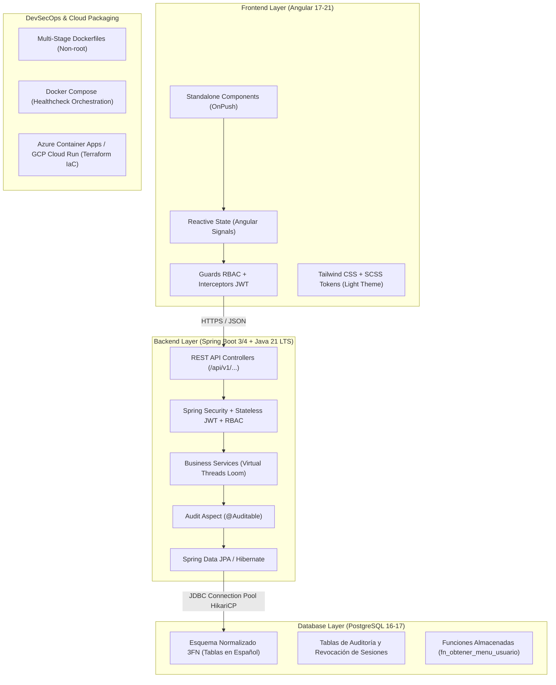
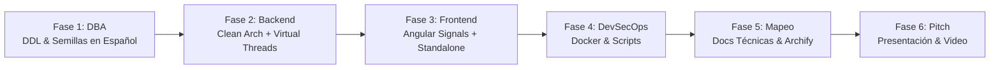

# PLAN MAESTRO DE ARQUITECTURA Y DESARROLLO FULL-STACK (BASE PARA AGENTES E IA)
> **Versión:** 1.0.0  
> **Ámbito de Aplicación:** Plataformas Web Empresariales, Sistemas Transaccionales, E-Commerce, ERP / POS Multisede.  
> **Compatibilidad de Modelos IA:** ChatGPT (GPT-4o/o1), Claude 3.5/3.7 Sonnet, Google Gemini 1.5/2.0 Pro, DeepSeek V3/R1, Antigravity, Mistral, Cursor / Copilot.

---

## 1. Propósito e Instrucciones para el Modelo de IA (System Prompt Header)

Este documento contiene el **blueprint arquitectónico estandarizado**, las **reglas de ingeniería inviolables**, los **patrones de diseño** y el **flujo de ejecución paso a paso** perfeccionados en este proyecto.

### Instrucción Directa para cualquier Modelo de IA:
```text
Actúa como un Ingeniero de Software Principal (Principal Full-Stack Architect & DevSecOps Lead). 
Tu objetivo es diseñar, codificar, probar y documentar módulos o sistemas completos siguiendo de 
forma estricta los estándares, nomenclatura, patrones de diseño y flujo operativo definidos en 
este documento (PLAN_MAESTRO_DESARROLLO_IA.md). 
No introduzcas desviaciones arbitrarias de stack, convenciones o seguridad sin justificación explícita.
```

---

## 2. Principios y Reglas Inviolables (Golden Rules)

Cualquier sistema desarrollado a partir de esta base debe respetar las siguientes 7 reglas maestras:

| # | Dominio | Regla Inviolable | Explicación / Justificación |
|---|---|---|---|
| **R1** | **Base de Datos** | **100% Nomenclatura en Español** | Schemas, tablas, columnas, índices, llaves foráneas (`fk_`), constraints (`chk_`, `uk_`), vistas y funciones deben estar escritos en español formal en `snake_case` (ej. `seguridad_usuario`, `fecha_emision`, `monto_total`). Cero spanglish en la capa de persistencia. |
| **R2** | **Arquitectura Backend** | **Clean Architecture + Java 21 LTS** | Spring Boot 3.2+ / 4.x con **Hilos Virtuales** (`spring.threads.virtual.enabled=true`). Separación estricta en capas: `config`, `common`, `security`, `audit` y `modules/<dominio>` (`domain`, `repository`, `service`, `controller`, `dto`, `mapper`). |
| **R3** | **Seguridad REST** | **Stateless JWT + RBAC + ProblemDetail RFC 9457** | Autenticación basada en tokens JWT con expiración estricta. Autorización jerárquica por roles y permisos granulares. Respuestas de error estandarizadas según RFC 9457 (`application/problem+json`). |
| **R4** | **Frontend Moderno** | **Angular 17+ Standalone + Signals** | Cero `NgModules`. Cada vista es un `Component` standalone con `ChangeDetectionStrategy.OnPush`. Gestión reactiva de estado usando **Signals** (`signal()`, `computed()`, `effect()`). Formularios con `ReactiveFormsModule` tipado. |
| **R5** | **Diseño & UX** | **Tema Claro Corporativo (Light Mode)** | Las interfaces de usuario, presentaciones ejecutivas y videos deben mantener una paleta luminosa de alta legibilidad (`#ffffff`, `#f8fafc`, acentos en azul eléctrico `#2563eb`, cian `#0284c7` y verde `#10b981`). Prohibido generar interfaces oscuras por defecto salvo solicitud explícita del usuario. |
| **R6** | **Menús y Navegación** | **RBAC Dinámico sin Iconos Huérfanos** | Los menús se resuelven recursivamente desde la base de datos según los roles del usuario. Si un ítem de menú **no tiene hijos** (`submenus.length === 0`), **nunca debe renderizar el chevron/flecha de despliegue** ni abrir contenedores vacíos. |
| **R7** | **DevSecOps** | **Contenedores Seguros sin Root + Healthchecks** | Dockerfiles multi-stage con imágenes base ligeras (Alpine / Eclipse Temurin). Ejecución bajo usuario no privilegiado (`appuser:10001`). `docker-compose.yml` con healthchecks obligatorios (`pg_isready`, `curl actuator/health`) y redes aisladas. |

---

## 3. Matriz Tecnológica del Stack Estándar



---

## 4. Estructura de Directorios Canónica del Monorepo

```text
nombre-del-proyecto/
├── PLAN_MAESTRO_DESARROLLO_IA.md # Este documento de referencia maestra
├── docker-compose.yml            # Orquestación local (db, backend, frontend)
├── start.ps1                     # Script maestro para Windows
├── start.sh                      # Script maestro para Linux / macOS
├── README.md                     # Documentación general y puesta en marcha
│
├── backend/                      # Módulo Backend Spring Boot
│   ├── src/main/java/com/empresa/proyecto/
│   │   ├── config/               # CorsConfig, OpenApiConfig, SecurityConfig
│   │   ├── common/               # GlobalExceptionHandler, ProblemDetail, DTOs genéricos
│   │   ├── security/             # JwtService, JwtFilter, CustomUserDetailsService, PermisoEvaluator
│   │   ├── audit/                # AuditoriaAspect, AuditoriaSesionService
│   │   └── modules/              # Módulos de dominio de negocio
│   │       ├── autenticacion/    # Login, Refresh, PasswordReset
│   │       ├── menu/             # Menú dinámico RBAC
│   │       ├── usuario/          # Gestión de usuarios y asignación de sedes
│   │       └── [negocio]/        # Ventas, Inventario, Clientes, etc.
│   ├── src/main/resources/
│   │   ├── application.yml       # Configuración con soporte a perfiles (dev, qa, prod)
│   │   └── db/migration/         # Scripts Flyway/Liquibase opcionales
│   ├── Dockerfile                # Multi-stage Eclipse Temurin JRE
│   └── pom.xml
│
├── frontend/                     # Módulo Frontend Angular
│   ├── src/app/
│   │   ├── core/                 # AuthInterceptor, ErrorInterceptor, AuthGuard, RoleGuard
│   │   ├── models/               # Interfaces TypeScript sincronizadas con DTOs backend
│   │   ├── services/             # Servicios HTTP con Signals para estado global
│   │   ├── shared/               # Componentes compartidos (Botones, Modales, Tablas)
│   │   ├── layout/               # Sidebar dinámico RBAC, Navbar, Footer
│   │   └── views/                # Vistas principales (1 componente standalone por ruta)
│   ├── Dockerfile                # Multi-stage Node.js build + Nginx Alpine
│   ├── nginx.conf                # Nginx con seguridad (X-Frame-Options, CSP, Gzip)
│   └── package.json
│
└── docs/                         # Documentación Centralizada y Artefactos
    ├── technical_frontend_interfaces_and_database_mapping.md # Mapeo técnico completo
    ├── sql/                      # Scripts DDL y Semillas 100% en Español
    │   ├── 01_schema_ddl.sql
    │   ├── 02_seed_dummy_data.sql
    │   └── README.md             # Diccionario de datos
    ├── cloud/                    # Blueprints Cloud (Azure & GCP), FinOps, CI/CD
    ├── diagrams/                 # Diagramas de Software (Archify / Mermaid)
    └── presentacion/             # Pitch Decks HTML, simuladores interactivos y videos
```

---

## 5. Especificaciones Detalladas por Capa

### 5.1. Capa de Base de Datos (DBA Senior - PostgreSQL 16-17)

1. **Convención de Nombres**:
   - Tablas en plural o singular consistente, siempre en minúsculas y `snake_case`.
   - Llaves primarias: `id` o `<nombre_tabla>_id` tipo `BIGINT GENERATED ALWAYS AS IDENTITY` o `UUID`.
   - Columnas de auditoría estándar en toda tabla de entidad:
     ```sql
     activo           BOOLEAN NOT NULL DEFAULT TRUE,
     creado_en        TIMESTAMP WITH TIME ZONE NOT NULL DEFAULT CURRENT_TIMESTAMP,
     actualizado_en   TIMESTAMP WITH TIME ZONE NOT NULL DEFAULT CURRENT_TIMESTAMP,
     creado_por       VARCHAR(50),
     actualizado_por  VARCHAR(50)
     ```
2. **Modelo RBAC Canónico**:
   - `seguridad_rol` (`id`, `codigo`, `nombre`, `descripcion`, `activo`).
   - `seguridad_usuario` (`id`, `nombre_usuario`, `clave_hash`, `correo_electronico`, `nombres`, `apellidos`, `intentos_fallidos`, `cuenta_bloqueada`, `clave_expira_en`, `sede_id`, `activo`).
   - `seguridad_rol_usuario` (`usuario_id`, `rol_id`).
   - `catalogo_menu` (`id`, `menu_padre_id`, `codigo`, `titulo`, `ruta_navegacion`, `icono`, `orden_visualizacion`, `es_agrupador`, `activo`).
   - `seguridad_permiso_menu` (`id`, `rol_id`, `menu_id`, `permite_crear`, `permite_leer`, `permite_actualizar`, `permite_eliminar`).
   - `auditoria_sesion_activa` (`id`, `usuario_id`, `token_jti`, `ip_origen`, `user_agent`, `fecha_inicio`, `ultima_actividad`, `esta_revocada`).

3. **Función de Menú Recursivo para el Usuario**:
   ```sql
   CREATE OR REPLACE FUNCTION fn_obtener_menu_usuario(p_usuario_id BIGINT)
   RETURNS TABLE (
       menu_id BIGINT,
       menu_padre_id BIGINT,
       titulo VARCHAR,
       ruta VARCHAR,
       icono VARCHAR,
       orden INT
   ) AS $$
   BEGIN
       RETURN QUERY
       SELECT DISTINCT m.id, m.menu_padre_id, m.titulo, m.ruta_navegacion, m.icono, m.orden_visualizacion
       FROM catalogo_menu m
       INNER JOIN seguridad_permiso_menu pm ON pm.menu_id = m.id
       INNER JOIN seguridad_rol_usuario ru ON ru.rol_id = pm.rol_id
       WHERE ru.usuario_id = p_usuario_id
         AND m.activo = TRUE
         AND pm.permite_leer = TRUE
       ORDER BY m.orden_visualizacion ASC;
   END;
   $$ LANGUAGE plpgsql SECURITY DEFINER;
   ```

---

### 5.2. Capa Backend (Spring Boot 3.2+ / Java 21 LTS)

1. **Habilitación de Hilos Virtuales (Project Loom)**:
   ```yaml
   spring:
     threads:
       virtual:
         enabled: true
   ```
2. **Estructura Estándar de Respuesta REST**:
   - Todo endpoint retorna `ResponseEntity<RespuestaApi<T>>` donde `RespuestaApi<T>` contiene:
     ```java
     public record RespuestaApi<T>(
         boolean exito,
         String mensaje,
         T datos,
         LocalDateTime marcaTiempo
     ) {
         public static <T> RespuestaApi<T> ok(T datos, String mensaje) {
             return new RespuestaApi<>(true, mensaje, datos, LocalDateTime.now());
         }
     }
     ```
3. **Manejo Centralizado de Excepciones (RFC 9457)**:
   ```java
   @RestControllerAdvice
   public class ManejadorExcepcionesGlobal {
       @ExceptionHandler(RecursoNoEncontradoException.class)
       public ProblemDetail manejarNoEncontrado(RecursoNoEncontradoException ex) {
           ProblemDetail problema = ProblemDetail.forStatusAndDetail(HttpStatus.NOT_FOUND, ex.getMessage());
           problema.setTitle("Recurso no encontrado");
           problema.setType(URI.create("https://api.empresa.com/errores/no-encontrado"));
           problema.setProperty("timestamp", Instant.now());
           return problema;
       }
   }
   ```
4. **Validación y DTOs Inmutables**:
   - Usar `record` de Java para DTOs con anotaciones `@NotBlank`, `@Size`, `@Positive`, etc.

---

### 5.3. Capa Frontend (Angular 17+ Standalone + Signals)

1. **Estructura de Componente Standalone**:
   ```typescript
   @Component({
     selector: 'app-catalogo-ventas',
     standalone: true,
     imports: [CommonModule, ReactiveFormsModule, RouterLink],
     templateUrl: './catalogo-ventas.component.html',
     styleUrls: ['./catalogo-ventas.component.scss'],
     changeDetection: ChangeDetectionStrategy.OnPush
   })
   export class CatalogoVentasComponent implements OnInit {
     private readonly ventasService = inject(VentasService);
     
     // Estado Reactivo con Signals
     readonly productos = this.ventasService.productos;
     readonly filtroCategoria = signal<string>('TODAS');
     
     readonly productosFiltrados = computed(() => {
       const cat = this.filtroCategoria();
       return cat === 'TODAS' 
         ? this.productos() 
         : this.productos().filter(p => p.categoria === cat);
     });
   }
   ```
2. **Lógica de Menú y Submenú (Regla Anti-Icono Huérfano)**:
   ```html
   <!-- En el template del Sidebar -->
   <div *ngFor="let item of menuItems()" class="nav-item">
     <div class="nav-link" (click)="toggleMenu(item)">
       <i [class]="item.icono"></i>
       <span>{{ item.titulo }}</span>
       <!-- SOLO mostrar el chevron si tiene submenús reales -->
       <i *ngIf="item.submenus && item.submenus.length > 0" 
          class="chevron-icon" 
          [class.expanded]="item.abierto"></i>
     </div>
     
     <!-- Contenedor de submenús solo se crea si hay hijos -->
     <div *ngIf="item.submenus && item.submenus.length > 0 && item.abierto" class="submenu-container">
       <a *ngFor="let sub of item.submenus" [routerLink]="sub.ruta" class="submenu-link">
         {{ sub.titulo }}
       </a>
     </div>
   </div>
   ```

---

### 5.4. Capa DevSecOps y Contenedores

1. **Dockerfile Multi-Stage para Backend**:
   - Etapa 1: Maven + OpenJDK 21 para compilar el JAR.
   - Etapa 2: Eclipse Temurin JRE 21 Alpine mínima.
   - Creación de usuario no root: `adduser -D -u 10001 appuser`.
2. **Dockerfile Multi-Stage para Frontend**:
   - Etapa 1: Node.js Alpine para `npm run build`.
   - Etapa 2: Nginx Unprivileged Alpine. Copia del `dist/` a `/usr/share/nginx/html`.
3. **Orquestación en `docker-compose.yml`**:
   - Healthcheck en PostgreSQL (`pg_isready -U postgres`).
   - `depends_on` con condición `service_healthy`.
   - Parámetros de reinicio: `restart: unless-stopped`.

---

## 6. Flujo de Trabajo para el Modelo de IA (AI Execution Lifecycle)

Cuando un usuario solicite a la IA desarrollar un nuevo módulo o proyecto completo, la IA debe ejecutar estas **6 Fases en estricto orden**:



1. **Fase 1 — DBA & Modelado Relacional (PostgreSQL)**:
   - Crear las tablas en español con auditoría y constraints.
   - Insertar registros en `catalogo_menu` y vincularlos a `seguridad_permiso_menu`.
   - Generar datos semilla consistentes.
2. **Fase 2 — Backend REST & Seguridad (Spring Boot)**:
   - Crear Entidades JPA con nombres mapeados a las tablas en español (`@Table(name = "...")`).
   - Crear DTOs inmutables (`record`) y Validadores.
   - Crear Repositorios, Servicios de negocio y Controladores REST con prefijo `/api/v1/...`.
   - Proteger endpoints con `@PreAuthorize("hasRole('...')")`.
3. **Fase 3 — Frontend Standalone (Angular)**:
   - Definir modelos TypeScript reflejando los DTOs.
   - Implementar Servicio con Signals y llamadas HTTP.
   - Crear Componente Standalone con estilos SCSS en tema claro.
   - Registrar la ruta en el router principal protegida por el `AuthGuard`.
4. **Fase 4 — DevSecOps & Automatización**:
   - Actualizar `docker-compose.yml` si se añaden dependencias.
   - Verificar la compatibilidad en `start.ps1` y `start.sh`.
5. **Fase 5 — Documentación Técnica y Mapeo**:
   - Registrar el nuevo flujo en `docs/technical_frontend_interfaces_and_database_mapping.md`.
   - Crear diagramas interactivos con Archify si hay flujos complejos.
6. **Fase 6 — Presentación y Comercialización**:
   - Actualizar la presentación interactiva para el cliente final (`PRESENTACION_INTERACTIVA_USUARIO.html`).

---

## 7. Prompts Estandarizados Listos para Copiar y Pegar en Cualquier IA

Para iniciar tareas específicas con cualquier modelo de IA, utiliza las siguientes plantillas:

### 📋 Template A: Creación de Módulo en Base de Datos (DBA Senior)
```text
Actúa como un DBA Senior PostgreSQL bajo el estándar PLAN_MAESTRO_DESARROLLO_IA.md.
Necesito modelar el módulo de: [NOMBRE DEL MÓDULO, ej. Gestión de Proveedores y Órdenes de Compra].
Requisitos:
1. Todas las tablas, columnas, constraints, índices y llaves foráneas deben estar 100% en español y snake_case.
2. Incluir columnas de auditoría estándar (activo, creado_en, actualizado_en, creado_por).
3. Diseñar en 3FN con tipos de datos óptimos (BIGINT, NUMERIC, TIMESTAMPTZ, UUID).
4. Generar el script DDL con comentarios, datos semilla realistas (seed data) y la inserción de las opciones de menú en `catalogo_menu` asociadas a los roles correspondientes.
```

### ☕ Template B: Creación de Módulo Backend (Spring Boot 3 + Java 21)
```text
Actúa como un Ingeniero Backend Senior bajo el estándar PLAN_MAESTRO_DESARROLLO_IA.md.
Implementa el backend para el módulo: [NOMBRE DEL MÓDULO].
Requisitos:
1. Stack: Java 21 LTS con Virtual Threads activados, Spring Boot 3.2+, Spring Data JPA, Spring Security.
2. Clean Architecture en paquete com.empresa.proyecto.modules.[modulo] (domain, repository, service, controller, dto, mapper).
3. Entidades JPA mapeadas a las tablas en español generadas en el paso anterior.
4. DTOs inmutables usando Java Records con Bean Validation (@NotNull, @Size, etc.).
5. Controlador REST con prefijo /api/v1/[recurso], respuestas envueltas en RespuestaApi<T> y manejo de errores con ProblemDetail RFC 9457.
6. Seguridad RBAC con anotaciones @PreAuthorize.
```

### 🅰️ Template C: Creación de Interfaz Frontend (Angular Standalone + Signals)
```text
Actúa como un Ingeniero Frontend Senior bajo el estándar PLAN_MAESTRO_DESARROLLO_IA.md.
Construye la vista frontend para: [NOMBRE DE LA VISTA, ej. Punto de Venta POS / Registro de Compras].
Requisitos:
1. Componente Standalone con ChangeDetectionStrategy.OnPush e inyección mediante inject().
2. Manejo reactivo de estado con Angular Signals (signal, computed, effect). Cero suscripciones manuales innecesarias.
3. Formulario reactivo tipado (ReactiveFormsModule) con validaciones y mensajes amigables.
4. Diseño en Tema Claro (Light Mode) con paleta corporativa moderna (blancos, grises suaves, azul #2563eb y cian #0284c7).
5. Cumplir con la regla anti-icono: si el elemento no tiene submenús, no debe mostrar flecha ni desplegar contenedor vacío.
```

### 🐳 Template D: Orquestación DevSecOps y Docker
```text
Actúa como un Ingeniero DevSecOps Senior bajo el estándar PLAN_MAESTRO_DESARROLLO_IA.md.
Genera los artefactos de despliegue para: [APLICACIÓN O SERVICIO NUEVO].
Requisitos:
1. Dockerfile multi-stage con build aislado y ejecución en usuario no-root (appuser:10001).
2. Configuración para docker-compose.yml con healthcheck estricto, límites de memoria/CPU y red compartida interna.
3. Compatibilidad con los scripts maestros start.ps1 (Windows) y start.sh (Linux).
```

---

## 8. Checklist de Verificación y Criterios de Aceptación (QA Gate)

Antes de considerar concluido cualquier desarrollo realizado por una IA, se debe validar esta lista de control:

- [ ] **DBA**: ¿El 100% de nombres de objetos SQL (tablas, columnas, índices) están en español sin términos en inglés?
- [ ] **DBA**: ¿Las nuevas vistas están registradas en `catalogo_menu` y vinculadas a `seguridad_permiso_menu`?
- [ ] **Backend**: ¿Se están utilizando Java Records para los DTOs y ProblemDetail RFC 9457 para excepciones?
- [ ] **Backend**: ¿Los endpoints validan los permisos de rol mediante Spring Security?
- [ ] **Frontend**: ¿El componente es Standalone y maneja su estado mediante Signals?
- [ ] **Frontend**: ¿La interfaz es en Tema Claro y el menú no muestra flechas de desplegable en ítems sin hijos?
- [ ] **DevOps**: ¿Los contenedores compilan y levantan con `healthcheck` en estado `healthy`?
- [ ] **Documentación**: ¿Se actualizó la matriz de mapeo frontend <-> backend <-> base de datos?

---

*Este plan maestro es un documento vivo y constituye la referencia canónica para mantener la consistencia técnica, estética y operativa en futuros desarrollos asistidos por Inteligencia Artificial.*
