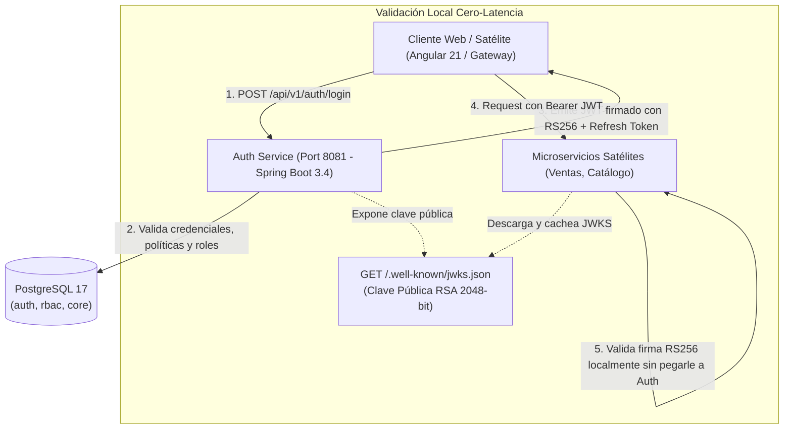
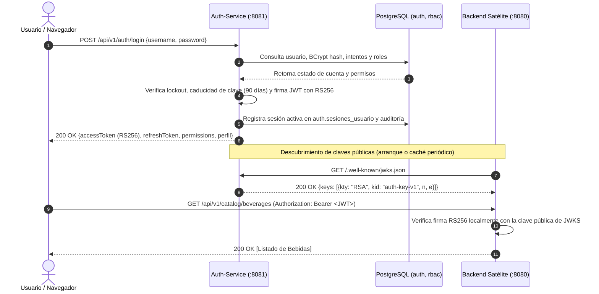

# 🛡️ Servicio Centralizado de Gestión de Identidad y Accesos (IAM / IdP)

Microservicio empresarial síncrono de **Autenticación Centralizada**, **Autorización RBAC**, **Gobierno de Sesiones Concurrentes** y **Emisión de Tokens Asimétricos (RS256 + JWKS)** construido con **Spring Boot 3.4**, **Java 21 LTS** e **Hilos Virtuales (Project Loom)**.

Este componente actúa como la **Fuente Única de Verdad** (Single Source of Truth) para la identidad de usuarios, rotación mandataria de contraseñas, auditoría inmutable de accesos y terminación remota de sesiones (Kill Session) para todas las aplicaciones satélites del ecosistema corporativo.

---

## 1. Principios y Flujo de Arquitectura



### Flujo de Secuencia: Autenticación e Inspección Cero-Latencia



---

## 2. Pilares Criptográficos y de Seguridad

1. **Tokens Asimétricos (RS256 + JWKS RFC 7517)**:
   - El servicio firma digitalmente los tokens JWT utilizando una **clave privada RSA de 2048 bits**.
   - Expone la clave pública en el endpoint estándar `GET /.well-known/jwks.json`.
   - Los microservicios consumidores validan la integridad y vigencia de las firmas de forma **100% local**, sin requerir tráfico HTTP de vuelta al Auth Service en cada petición.
2. **Introspección RFC 7662**:
   - Para pasarelas (API Gateways) que requieran comprobación en tiempo real de revocaciones o estado de sesión, el endpoint `POST /api/v1/auth/introspect` expone la verificación activa del token.
3. **Aislamiento Multitenant y Sedes**:
   - El token incorpora reclamos empresariales: `business_id`, `business_code`, `assigned_branch_id`, `assigned_branch_name` y la lista de `authorized_branches`.
4. **Respuestas RFC 7807 (ProblemDetail)**:
   - Todos los errores devuelven un formato JSON uniforme con tipo URI, título, código HTTP, detalle del error y timestamp.

---

## 3. Catálogo Completo de Endpoints REST

### Autenticación y Proveedor de Identidad (IdP)

| Método | Endpoint | Descripción | Acceso | Código HTTP |
| :--- | :--- | :--- | :--- | :--- |
| `POST` | `/api/v1/auth/login` | Valida credenciales, comprueba políticas de bloqueo y caducidad, emite par de tokens (RS256 y refresco). | Público | `200`, `401`, `403`, `423` |
| `POST` | `/api/v1/auth/refresh` | Valida el token de refresco, lo rota y emite un nuevo token de acceso. | Público | `200`, `401` |
| `POST` | `/api/v1/auth/introspect` | Introspección RFC 7662 del token de acceso para gateways y satélites. | Público | `200` |
| `GET` | `/.well-known/jwks.json` | Descubrimiento RFC 7517 del conjunto de claves públicas para validación local. | Público | `200` |
| `POST` | `/api/v1/auth/logout` | Revoca la sesión activa y da de baja el token de refresco en la base de datos. | Autenticado | `200` |
| `POST` | `/api/v1/auth/change-password`| Actualiza contraseña, resetea fecha de expiración y revoca todas las sesiones previas. | Autenticado | `200`, `401` |
| `GET` | `/api/v1/auth/health` | Sonda de disponibilidad y estado del servicio. | Público | `200` |

### Monitoreo y Gobierno de Sesiones (Kill Session)

| Método | Endpoint | Descripción | Acceso | Código HTTP |
| :--- | :--- | :--- | :--- | :--- |
| `GET` | `/api/v1/sessions` | Lista las conexiones activas consolidadas con IP, navegador, dispositivo y ubicación. | `ADMIN`, `AUDITOR`, `SUPERVISOR` | `200`, `403` |
| `POST` | `/api/v1/sessions/revoke` | Desconexión remota de sesión forzosa (**Kill Session**) con motivo justificado. | `ADMIN` | `200`, `403` |
| `POST` | `/api/v1/sessions/{id}/heartbeat` | Registra presencia periódica actualizando la fecha de última actividad. | Autenticado | `200` |

### Directorio y Gobierno de Usuarios

| Método | Endpoint | Descripción | Acceso | Código HTTP |
| :--- | :--- | :--- | :--- | :--- |
| `GET` | `/api/v1/users` | Listado consolidado de usuarios con empresa, sede principal y sedes autorizadas. | `ADMIN`, `AUDITOR`, `SUPERVISOR` | `200`, `403` |
| `GET` | `/api/v1/users/{id}` | Detalle completo de la identidad y estado de un usuario por su UUID. | `ADMIN`, `AUDITOR`, Propietario | `200`, `404` |
| `POST` | `/api/v1/users` | Aprovisionamiento de nuevo usuario, rol RBAC y vinculación de sucursales. | `ADMIN` | `201`, `422` |
| `PUT` | `/api/v1/users/{id}/lock` | Bloqueo administrativo de cuenta por seguridad. | `ADMIN` | `200` |
| `PUT` | `/api/v1/users/{id}/unlock` | Desbloqueo administrativo de cuenta y reseteo de intentos fallidos. | `ADMIN` | `200` |

---

## 4. Configuración y Variables de Entorno

| Variable | Descripción | Valor por Defecto |
| :--- | :--- | :--- |
| `SERVER_PORT` | Puerto de escucha HTTP | `8081` |
| `SPRING_DATASOURCE_URL` | URL de conexión a PostgreSQL | `jdbc:postgresql://dev-postgres:5432/admin_dashboard` |
| `SPRING_DATASOURCE_USERNAME` | Usuario de base de datos | `admin_user` |
| `SPRING_DATASOURCE_PASSWORD` | Contraseña de base de datos | `admin_secure_password_2026` |
| `AUTH_SECURITY_JWT_KEY_ID` | Identificador de clave JWK | `auth-key-v1` |
| `AUTH_SECURITY_JWT_ISSUER` | Emisor URI de los tokens | `https://auth.enterprise.internal` |
| `AUTH_SECURITY_JWT_ACCESS_EXP`| Minutos de vigencia del token de acceso | `30` |
| `AUTH_SECURITY_JWT_REFRESH_EXP`| Días de vigencia del token de refresco | `7` |
| `AUTH_SECURITY_LOCKOUT_MAX_ATTEMPTS` | Intentos fallidos antes del bloqueo | `5` |
| `AUTH_SECURITY_PASSWORD_WARNING_DAYS` | Umbral en días para advertir caducidad | `7` |

---

## 5. Validación y Pruebas Rápidas con cURL

### 1. Comprobar Salud del Servicio
```bash
curl -s http://localhost:8081/api/v1/auth/health
```

### 2. Consultar Conjunto de Claves Públicas (JWKS)
```bash
curl -s http://localhost:8081/.well-known/jwks.json
```

### 3. Iniciar Sesión (Login)
```bash
curl -s -X POST http://localhost:8081/api/v1/auth/login \
  -H "Content-Type: application/json" \
  -d '{"username": "agarcia", "password": "Password123!"}'
```

### 4. Renovar Token (Refresh)
```bash
curl -s -X POST http://localhost:8081/api/v1/auth/refresh \
  -H "Content-Type: application/json" \
  -d '{"refreshToken": "<TOKEN_DE_REFRESCO>"}'
```

---

## 6. Despliegue con Docker Compose

Compilación y arranque aislado del microservicio:

```bash
# Compilar imagen y reiniciar contenedor dev-auth-service
docker compose build dev-auth-service && docker compose up -d dev-auth-service

# Consultar logs en tiempo real
docker compose logs -f dev-auth-service
```
