# COTIC — SISTEMA POS & GESTIÓN DE PRODUCTOS
## Manual de Usuario Oficial del Sistema

> **Perfil de Operación:** Raúl Ambrocio Mendoza (`rambrocio` / `USR-431`)  
> **Rol Asignado:** Administrador de Negocio (`ADMIN_NEGOCIO`)  
> **Versión del Sistema:** COTIC Pro v2.4 (Enterprise Multi-Empresa & Multi-Sede)  
> **Fecha de Actualización:** Noviembre 2026  
> **Descarga en PDF:** [📄 **Descargar Manual Oficial Completo en PDF (1.9 MB)**](MANUAL_DE_USUARIO_COTIC.pdf) | [🌐 **Ver Manual Interactivo Web**](index.html)  

---

## 1. Identidad Institucional y Perfil de Usuario

COTIC es una plataforma integral diseñada para la gestión comercial, control estricto de existencias, terminal de punto de venta (POS) de alta velocidad y cuadre contable blindado. El sistema soporta múltiples tipos de productos (abarrotes, bebidas, limpieza, snacks, golosinas y consumo masivo) operando bajo esquemas multi-tienda y multi-divisa (PEN, USD, EUR).

| Parámetro | Valor de Configuración |
|---|---|
| **Nombre Comercial** | **COTIC: SISTEMA POS & GESTIÓN DE PRODUCTOS** |
| **Ícono Distintivo** | `bi-box-seam-fill` (📦 Caja / Mercadería General) |
| **Usuario Activo** | **Raúl Ambrocio Mendoza** |
| **Identificador de Usuario** | `rambrocio` (`USR-431`) |
| **Nivel de Privilegios** | Nivel Negocio (Control Multi-Local y Auditoría Total) |
| **Sede Central** | Sede Central Mayorista (Caja 01 / Almacén Principal) |
| **Políticas de Sesión** | Token Bearer en memoria de pestaña (`sessionStorage`), expiración por inactividad y cierre forzado |

---

## 2. Índice de Módulos Operativos

1. [Módulo 1: Acceso Seguro y Autenticación Corporativa](#módulo-1-acceso-seguro-y-autenticación-corporativa)
2. [Módulo 2: Panel de Control e Indicadores en Vivo (Dashboard)](#módulo-2-panel-de-control-e-indicadores-en-vivo-dashboard)
3. [Módulo 3: Terminal de Punto de Venta POS (Ventas Mayor y Menor)](#módulo-3-terminal-de-punto-de-venta-pos-ventas-mayor-y-menor)
4. [Módulo 4: Historial de Ventas y Comprobantes Emitidos](#módulo-4-historial-de-ventas-y-comprobantes-emitidos)
5. [Módulo 5: Catálogo de Inventario y Consulta Histórica de Producto](#módulo-5-catálogo-de-inventario-y-consulta-histórica-de-producto)
6. [Módulo 6: Categorías y Familias de Productos](#módulo-6-categorías-y-familias-de-productos)
7. [Módulo 7: Compras y Abastecimiento de Mercadería](#módulo-7-compras-y-abastecimiento-de-mercadería)
8. [Módulo 8: Directorio y Gestión de Proveedores](#módulo-8-directorio-y-gestión-de-proveedores)
9. [Módulo 9: Arqueo, Movimientos y Cuadre de Caja](#módulo-9-arqueo-movimientos-y-cuadre-de-caja)
10. [Módulo 10: Cupones y Políticas de Descuento](#módulo-10-cupones-y-políticas-de-descuento)
11. [Módulo 11: Cartera y Fidelización de Clientes](#módulo-11-cartera-y-fidelización-de-clientes)
12. [Módulo 12: Configuración Multi-Empresa y Gestión de Sedes](#módulo-12-configuración-multi-empresa-y-gestión-de-sedes)
13. [Módulo 13: Administración de Usuarios y Operadores](#módulo-13-administración-de-usuarios-y-operadores)
14. [Módulo 14: Matriz de Roles y Control de Acceso RBAC](#módulo-14-matriz-de-roles-y-control-de-acceso-rbac)
15. [Módulo 15: Monitoreo de Sesiones y Desconexión Forzada (Kill-Session)](#módulo-15-monitoreo-de-sesiones-y-desconexión-forzada-kill-session)
16. [Módulo 16: Auditoría de Vulnerabilidades y Seguridad Defensiva](#módulo-16-auditoría-de-vulnerabilidades-y-seguridad-defensiva)

---

## Módulo 1: Acceso Seguro y Autenticación Corporativa

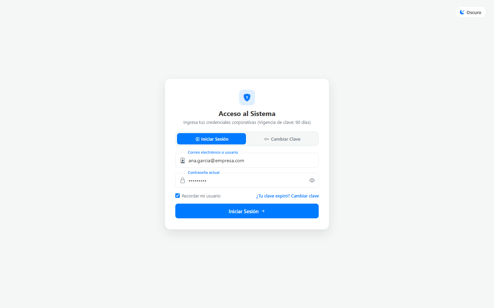

### Propósito
Garantizar el acceso autenticado y la protección perimetral del sistema conforme a estándares de ciberseguridad OWASP.

### Especificación Operativa
- **Ruta de Acceso:** `/login`
- **Campos Requeridos:**
  1. **Usuario / Correo:** Ingrese su identificador institucional (`rambrocio` o `rambrocio@gmail.com`).
  2. **Contraseña:** Clave criptográfica validada con algoritmo BCrypt (mínimo 8 caracteres, alfanumérico con caracteres especiales).
- **Mecanismos de Protección:**
  - Contador de intentos fallidos: A los 5 intentos consecutivos erróneos, la cuenta entra en estado `LOCKED` automático.
  - Almacenamiento volátil: La sesión se destruye inmediatamente al cerrar la pestaña del navegador para evitar sustracción de credenciales en equipos compartidos.
- **Acción:** Presione el botón azul **"Iniciar Sesión"** para ingresar al entorno de trabajo.

---

## Módulo 2: Panel de Control e Indicadores en Vivo (Dashboard)

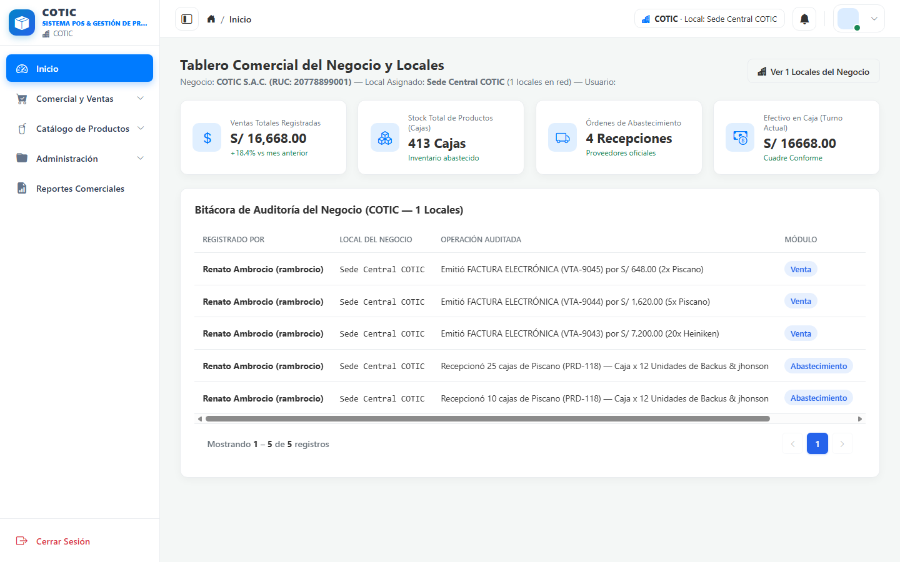

### Propósito
Brindar una visión panorámica en tiempo real del desempeño comercial, alertas de stock bajo y métricas financieras consolidadas.

### Especificación Operativa
- **Ruta de Acceso:** `/dashboard/inicio`
- **Bloques Principales:**
  1. **Cabecera Institucional Fija (Sidebar):** Muestra el badge oficial **COTIC: SISTEMA POS & GESTIÓN DE PRODUCTOS** con ícono `bi-box-seam-fill`, junto con el selector dinámico de empresa activa y la sede seleccionada.
  2. **Tarjetas KPI Consolidadas:**
     - *Ventas del Día:* Total facturado acumulado en la jornada actual.
     - *Transacciones:* Número de tickets, boletas y facturas emitidas.
     - *Productos con Stock Crítico:* Alertas de mercadería por debajo del umbral mínimo de seguridad.
     - *Margen Comercial:* Utilidad neta estimada en base al costo promedio ponderado.
  3. **Gráficos de Tendencia:** Curvas horarias de afluencia de cobro en mostrador y ranking de los 5 productos con mayor rotación.

---

## Módulo 3: Terminal de Punto de Venta POS (Ventas Mayor y Menor)

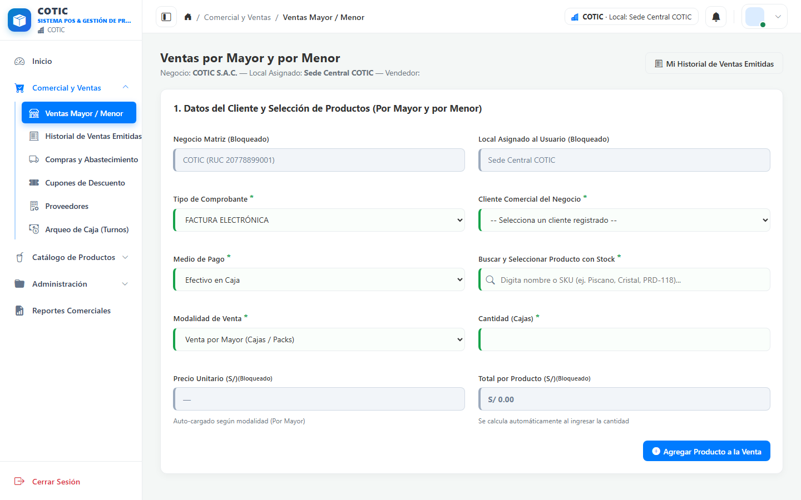

### Propósito
Agilizar el cobro y la emisión de comprobantes en mostrador en menos de 5 segundos, soportando ventas por unidad y por empaque mayorista.

### Especificación Operativa
- **Ruta de Acceso:** `/dashboard/sales`
- **Flujo de Atención en 4 Pasos:**
  1. **Selección de Cliente:** Seleccione *Público General* para ventas rápidas o busque por DNI / RUC en el padrón para emisión formal.
  2. **Búsqueda y Carga de Artículos:** 
     - Escanee con lector de código de barras o escriba en la barra de búsqueda reactiva.
     - Filtre por categorías (Abarrotes, Bebidas, Limpieza, etc.).
  3. **Modalidad de Venta Dual:**
     - *Venta por Menor:* Calcula precio unitario al detalle.
     - *Venta por Mayor:* Aplica tarifa especial automática al seleccionar presentación por caja o fardo cerrado.
  4. **Liquidación y Cuadre:**
     - Ingrese cupones de descuento válidos si el cliente presenta uno.
     - Seleccione el método de pago (Efectivo, Tarjeta, Transferencia digital o Mixto).
     - El sistema calcula el Subtotal Base, el Impuesto Oficial (18%) y el Total a pagar, registrando el cambio/vuelto exacto.
  5. **Comprobante:** Presione **"Confirmar y Emitir"** para disparar la impresión del ticket y rebajar el stock en tiempo real.

---

## Módulo 4: Historial de Ventas y Comprobantes Emitidos

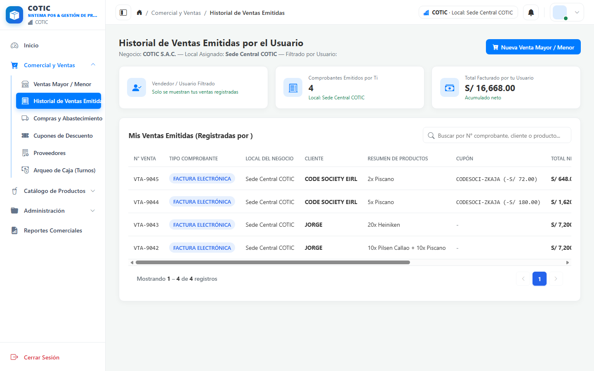

### Propósito
Auditar todas las operaciones comerciales emitidas, consultar comprobantes y procesar cancelaciones autorizadas.

### Especificación Operativa
- **Ruta de Acceso:** `/dashboard/sales-history`
- **Funcionalidades Clave:**
  - **Filtros Avanzados:** Filtrado instantáneo por rango de fechas, número de comprobante (serie y correlativo), cliente, modalidad (Mayor/Menor) y estado (`EMITIDA`, `ANULADA`).
  - **Detalle de Transacción:** Clic en cualquier registro para inspeccionar los ítems vendidos, método de liquidación y operador que atendió la caja.
  - **Reimpresión:** Descarga en formato PDF o impresión directa en ticketera térmica (80mm / 58mm).
  - **Anulación Controlada:** Requiere rol supervisor o administrador; restituye automáticamente las cantidades al stock de almacén y asienta el contra-asiento en caja.

---

## Módulo 5: Catálogo de Inventario y Consulta Histórica de Producto

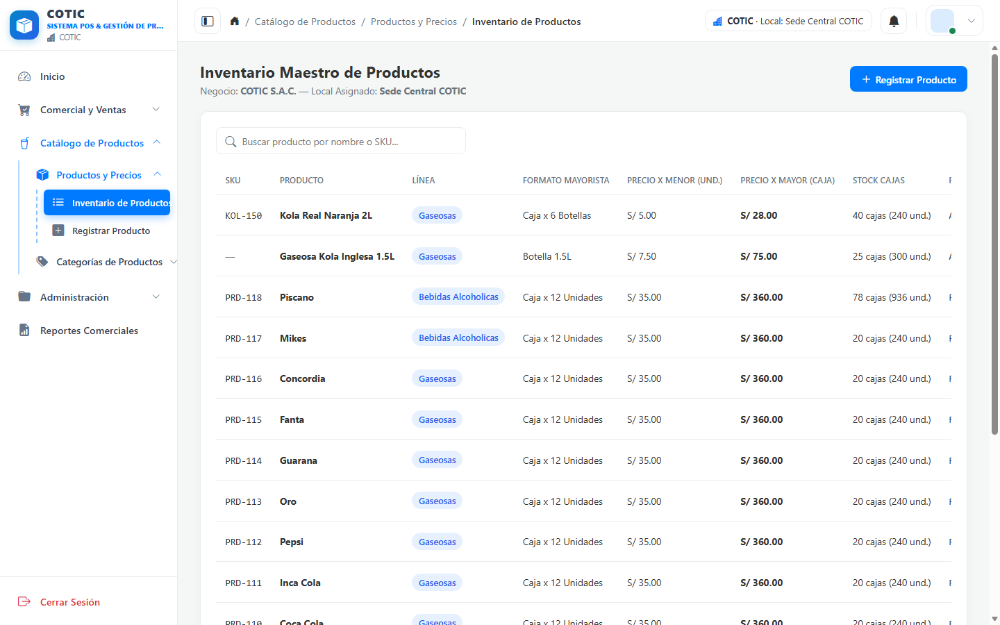

### Propósito
Administrar el maestro de artículos, presentaciones, códigos SKU, costos de adquisición y precios de venta multirubro.

### Especificación Operativa
- **Ruta de Acceso:** `/dashboard/products/list`
- **Campos del Maestro:**
  - *Nombre del Producto, SKU, Código de Barras y Categoría.*
  - *Unidades por Empaque:* Factor de conversión para cálculo de cajas o bultos.
  - *Stock Actual:* Control doble expresado en cajas completas y unidades sueltas disponibles.
  - *Precios:* Costo de compra, precio de venta al por mayor y precio de venta al detalle.

### Funcionalidad Exclusiva: Histórico de Compras y Ventas por Producto (Ejemplo con "Piscano" - SKU PRD-118)

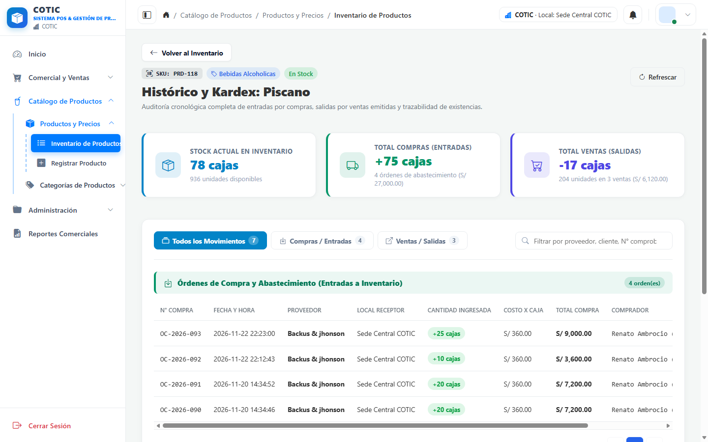

Para auditar el ciclo de vida completo de un artículo con información real de movimientos:
1. En la tabla de inventario, localice el producto **Piscano** (Código SKU: `PRD-118`, Categoría: *Bebidas Alcoholicas*).
2. En la columna **Acciones**, haga clic en el botón circular **`bi-clock-history` (Histórico de Movimientos)**.
3. Se desplegará la ventana modal interactiva de alta precisión con:
   - **KPI 1 - Stock Actual:** Existencias físicas en almacén y tiendas para el producto Piscano.
   - **KPI 2 - Total Compras (Entradas):** Número de órdenes de compra recibidas del proveedor oficial, cajas ingresadas e importe total invertido.
   - **KPI 3 - Total Ventas (Salidas):** Número de comprobantes emitidos en mostrador, unidades despachadas e ingresos recaudados.
   - **Pestaña Compras:** Tabla cronológica detallando fecha de recepción, proveedor, cantidad de cajas adquiridas, costo unitario y total pagado.
   - **Pestaña Ventas:** Tabla cronológica detallando número de comprobante, modalidad (Por Mayor / Por Menor), unidades descontadas, precio unitario y subtotal al centavo.

---

## Módulo 6: Categorías y Familias de Productos

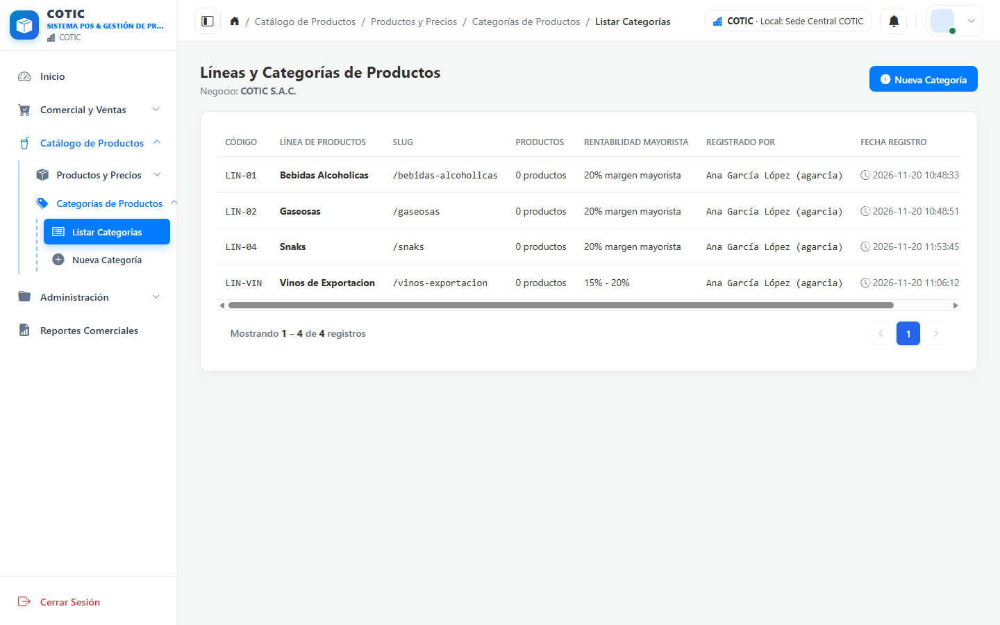

### Propósito
Estructurar y segmentar el catálogo de mercadería en familias y subfamilias comerciales para facilitar la búsqueda en el terminal POS y los reportes de rentabilidad.

### Especificación Operativa
- **Ruta de Acceso:** `/dashboard/categories`
- **Operaciones Disponibles:**
  - **Nueva Categoría:** Ingrese nombre (ej. *Bebidas y Refrescos*, *Abarrotes de Primera Necesidad*, *Snacks y Golosinas*, *Artículos de Limpieza*), código nemotécnico y estado de visibilidad.
  - **Edición y Reordenamiento:** Asignación de íconos temáticos para el POS táctil.
  - **Consistencia:** No se permite eliminar categorías que posean artículos activos vinculados.

---

## Módulo 7: Compras y Abastecimiento de Mercadería

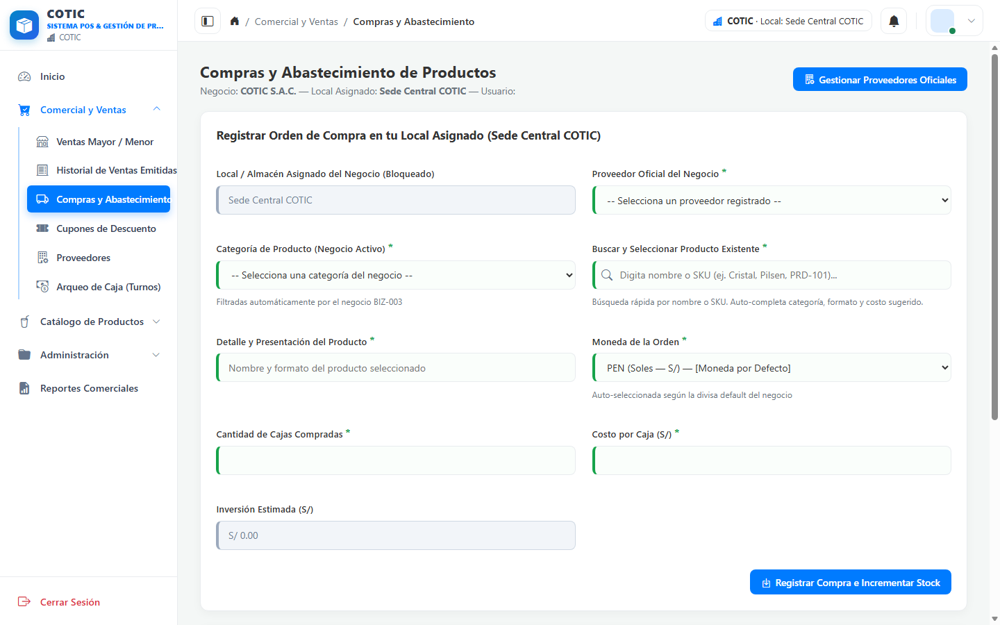

### Propósito
Registrar los ingresos de mercadería provenientes de distribuidores y proveedores oficiales, actualizando existencias y cuentas por pagar.

### Especificación Operativa
- **Ruta de Acceso:** `/dashboard/purchases`
- **Flujo de Ingreso de Mercadería:**
  1. Seleccione el proveedor del catálogo oficial.
  2. Indique la sede física de destino donde se recepcionará la carga.
  3. Ingrese el número de factura o guía de remisión del proveedor.
  4. Añada los ítems indicando cantidad de cajas/bultos recibidos y costo pactado.
  5. Al pulsar **"Registrar Compra"**, el sistema incrementa de forma atómica el stock disponible en inventario y alimenta el histórico del producto.

---

## Módulo 8: Directorio y Gestión de Proveedores

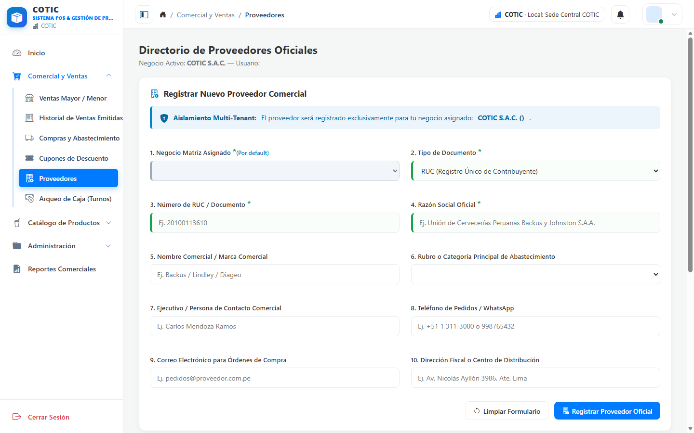

### Propósito
Mantener el padrón centralizado de empresas proveedoras, mayoristas y distribuidores de mercadería.

### Especificación Operativa
- **Ruta de Acceso:** `/dashboard/suppliers`
- **Ficha del Proveedor:**
  - *RUC / Identificación Fiscal Oficial.*
  - *Razón Social y Nombre Comercial.*
  - *Teléfono, Correo Electrónico y Dirección de Despacho.*
  - *Plazos de Crédito Acordados (Contado, 15 días, 30 días).*
  - *Estado:* Activo / Inactivo para compras.

---

## Módulo 9: Arqueo, Movimientos y Cuadre de Caja

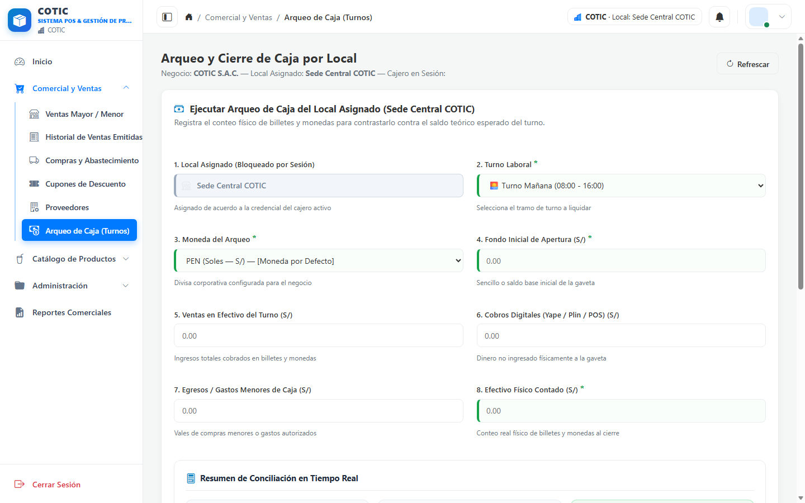

### Propósito
Blindar el flujo de efectivo en cada turno de trabajo, evitando descuadres entre el dinero físico recaudado y el registro del sistema.

### Especificación Operativa
- **Ruta de Acceso:** `/dashboard/cash-register`
- **Ciclo Operativo de Caja:**
  1. **Apertura de Caja:** El cajero ingresa el fondo de sencillo inicial (ej. S/ 150.00). La caja pasa a estado `ABIERTA`.
  2. **Movimientos Durante el Turno:**
     - Las ventas en efectivo se suman automáticamente.
     - Permite asentar entradas y salidas extraordinarias justificadas (ej. pago de flete menor, compra de insumos de mostrador).
  3. **Arqueo y Cierre:**
     - Al concluir la jornada, el cajero realiza el conteo físico de billetes y monedas.
     - El sistema compara el *Efectivo Esperado* vs. *Efectivo Contado*.
     - Se genera el acta de cierre indicando si la caja cuadró con balance cero, sobrante o faltante justificado.

---

## Módulo 10: Cupones y Políticas de Descuento

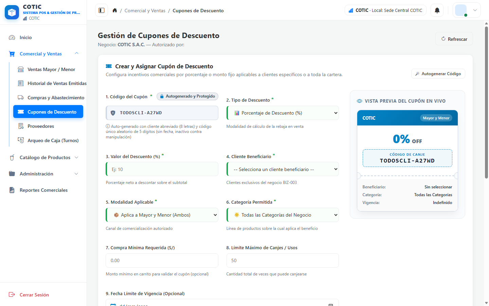

### Propósito
Crear promociones comerciales, incentivos de compra y campañas de fidelización con control de vigencia.

### Especificación Operativa
- **Ruta de Acceso:** `/dashboard/coupons`
- **Configuración de Campañas:**
  - *Código del Cupón:* Texto que ingresará el cajero en el POS (ej. `PROMO10`, `MAYORISTA5`).
  - *Tipo de Beneficio:* Porcentaje de descuento (%) o Rebaja fija en moneda local (S/).
  - *Monto Mínimo de Compra:* Condición requerida para que el descuento sea aplicable.
  - *Vigencia y Límite de Canjes:* Fechas límite y cantidad máxima de usos permitidos.

---

## Módulo 11: Cartera y Fidelización de Clientes

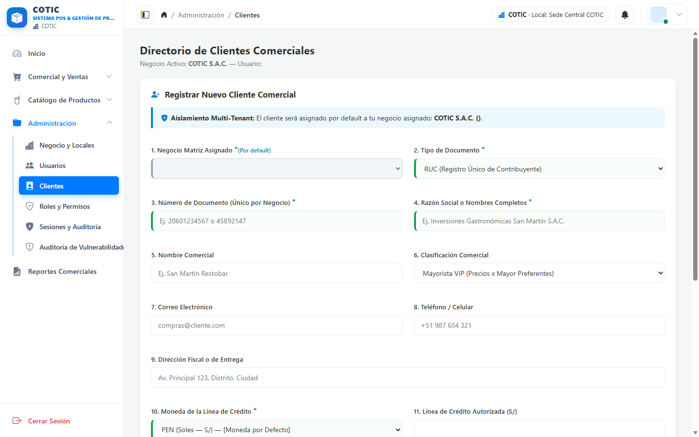

### Propósito
Gestionar la base de datos de compradores frecuentes, negocios minoristas asociados y clientes corporativos.

### Especificación Operativa
- **Ruta de Acceso:** `/dashboard/customers`
- **Segmentación:**
  - *Clientes Minoristas:* Personas naturales identificadas con DNI para emisión de boletas.
  - *Clientes Mayoristas VIP:* Negocios y distribuidoras identificados con RUC, dirección fiscal y condiciones de facturación.
  - *Historial de Consumo:* Métricas del volumen total comprado por cada cliente y frecuencia de visita.

---

## Módulo 12: Configuración Multi-Empresa y Gestión de Sedes

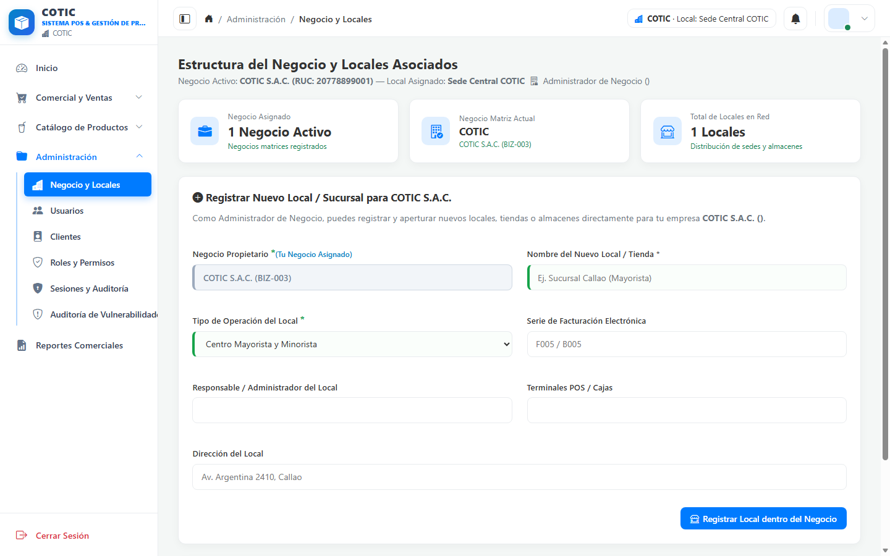

### Propósito
Administrar la arquitectura multirubro del sistema: definición de empresas del grupo, sedes comerciales y almacenes satélites.

### Especificación Operativa
- **Ruta de Acceso:** `/dashboard/branches`
- **Parámetros Institucionales:**
  - *Empresas Registradas:* Configuración de razón social, RUC corporativo y moneda base (PEN, USD, EUR).
  - *Sedes y Locales:* Creación de locales de venta y depósitos logísticos con dirección y teléfono.
  - *Aislamiento de Información:* Cada sede mantiene su propio stock y series correlativas de comprobantes, permitiendo a `rambrocio` auditar todas las sedes de forma centralizada.

---

## Módulo 13: Administración de Usuarios y Operadores

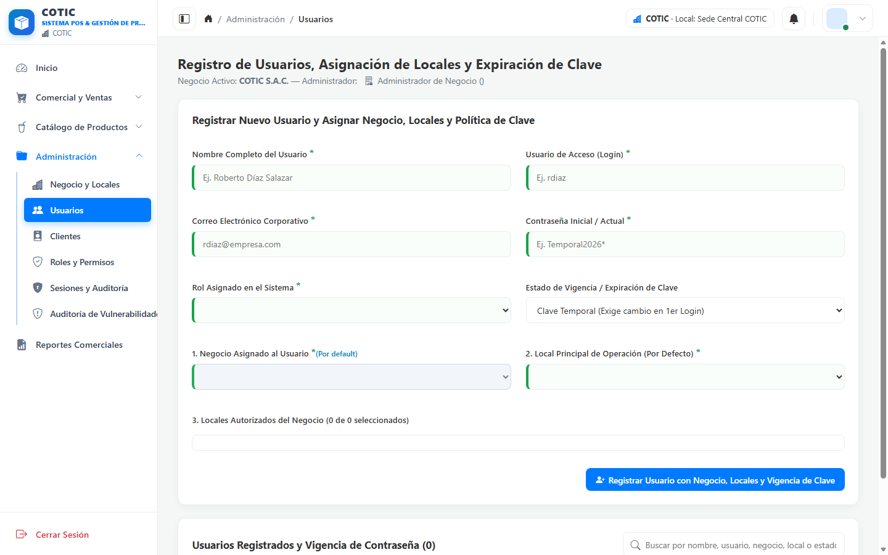

### Propósito
Controlar el ciclo de vida de los colaboradores del sistema: altas, asignación de sedes operativas, modificación de perfiles y bajas.

### Especificación Operativa
- **Ruta de Acceso:** `/dashboard/users`
- **Atributos de Cuenta:**
  - *Nombre Completo, Nombre de Usuario y Correo Corporativo.*
  - *Sede Asignada:* Local donde el operador está facultado para vender o recibir mercadería.
  - *Estado de Cuenta:* `ACTIVE` (Habilitado), `INACTIVE` (Desactivado), `LOCKED` (Bloqueado por seguridad).
  - *Restablecimiento de Credenciales:* Botón para emitir una nueva clave segura con expiración programada de 90 días.

---

## Módulo 14: Matriz de Roles y Control de Acceso RBAC

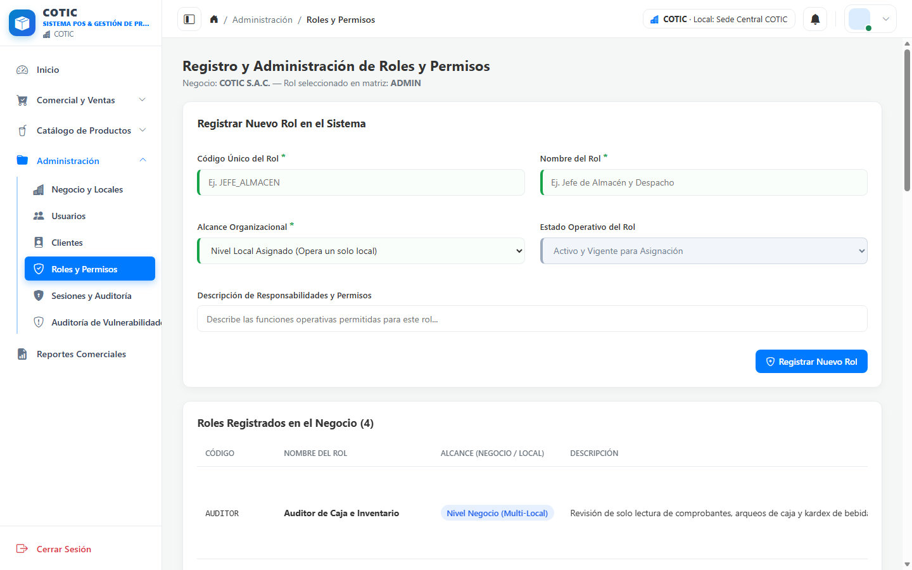

### Propósito
Definir los niveles jerárquicos de autorización en base al principio de mínimo privilegio (Role-Based Access Control).

### Especificación Operativa
- **Ruta de Acceso:** `/dashboard/roles`
- **Estructura de Roles Preconfigurada:**
  1. `SUPER_ADMIN`: Administrador tecnológico global de la infraestructura.
  2. `ADMIN_NEGOCIO`: Administrador general comercial (perfil de **Raúl Ambrocio Mendoza**). Acceso a todos los módulos de negocio, reportes y configuración multilocales.
  3. `SUPERVISOR_SEDE`: Encargado de tienda con facultades para arqueo de caja y anulación de comprobantes.
  4. `CAJERO_POS`: Operador de mostrador con acceso restringido exclusivamente al terminal de ventas y consulta básica de stock.
  5. `ALMACENERO`: Operador logístico enfocado en recepción de compras y transferencias.

---

## Módulo 15: Monitoreo de Sesiones y Desconexión Forzada (Kill-Session)

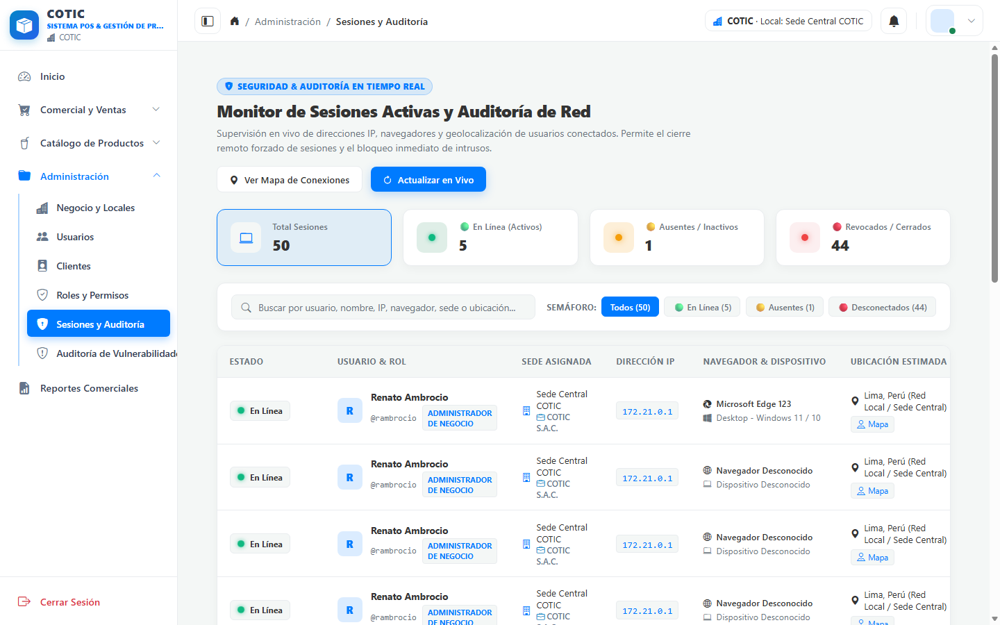

### Propósito
Supervisar en vivo los accesos simultáneos a la plataforma con control de acceso multi-empresa estricto y mitigar riesgos de intrusión mediante expulsión inmediata de sesiones no autorizadas.

### Especificación Operativa
- **Ruta de Acceso:** `/dashboard/sessions`
- **Aislamiento Multi-Negocio vs. Superadmin:**
  - El usuario **Raúl Ambrocio Mendoza** (`rambrocio`), con rol `ADMIN_NEGOCIO`, visualiza única y exclusivamente las sesiones activas pertenecientes a su empresa (**COTIC S.A.C.**), protegiendo la confidencialidad de la información operativa.
  - Los usuarios con rol `SUPERADMIN` tienen visibilidad panorámica global de todos los negocios y colaboradores conectados en el sistema.
- **Métricas del Monitor:**
  - Identificador de usuario, nombre completo y rol.
  - Empresa vinculada y local / sede.
  - Dirección IP de origen y navegador / sistema operativo cliente.
  - Hora de inicio de sesión y hora del último latido de actividad.
- **Botón "Kill Session":** Cierra inmediatamente el token JWT del usuario sospechoso o inactivo, impidiendo cualquier operación posterior y redirigiéndolo al `/login`.

---

## Módulo 16: Auditoría de Vulnerabilidades y Seguridad Defensiva

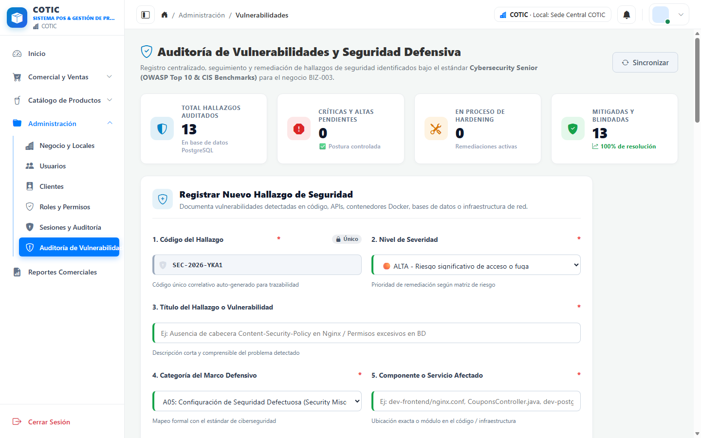

### Propósito
Centralizar el registro, trazabilidad y gestión del ciclo de vida de los hallazgos de seguridad técnica, auditorías de código (SAST/DAST), cumplimiento de estándares OWASP Top 10 y hardening de infraestructura de contenedores. Permite documentar la solución técnica aplicada para cada vulnerabilidad y auditar las mitigaciones en tiempo real.

### Especificación Operativa
- **Ruta de Acceso:** `/dashboard/vulnerabilities`
- **Ícono en Menú:** `bi-shield-check` (🛡️ Escudo de Seguridad Defensiva)
- **Ordenamiento Natural de la Tabla:**
  - La tabla principal se encuentra ordenada **descendentemente por código de últimos a primeros** (`SEC-2026-014`, `SEC-2026-013` ... hasta `SEC-2026-001`), permitiendo que los hallazgos y auditorías más recientes aparezcan siempre en la parte superior para una revisión prioritaria inmediata.
- **Filtros Reactivos y Búsqueda:**
  - *Filtro por Severidad:* Todos (`ALL`), Crítica (`CRITICA`), Alta (`ALTA`), Media (`MEDIA`), Baja (`BAJA`), Informativa (`INFO`).
  - *Filtro por Estado:* Todos (`ALL`), Abierto (`ABIERTO`), En Proceso (`EN_PROCESO`), Mitigado (`MITIGADO`), Falso Positivo (`FALSO_POSITIVO`), Riesgo Aceptado (`ACEPTADO`).
  - *Búsqueda en Vivo:* Búsqueda por código, título, componente afectado, categoría o usuario auditor.
- **Campos Principales de la Tabla:**
  1. **Código:** Identificador único normalizado (ej. `SEC-2026-013`).
  2. **Severidad:** Badge con coloración de riesgo (Rojo = Crítica, Naranja = Alta, Amarillo = Media, Azul = Baja, Gris = Informativa).
  3. **Título y Categoría:** Nombre del hallazgo y clasificación técnica (ej. *OWASP A01: Broken Object Level Authorization*, *CIS Docker Benchmark 5.25*, *OWASP A05: Security Misconfiguration*).
  4. **Componente Afectado:** Servicio, endpoint o archivo vulnerable (ej. `dev-frontend / Nginx`, `auth-service / SecurityConfig`, `OrganizationController`).
  5. **Estado de Remediación:** Estado actual dentro del ciclo de vida del hallazgo.
  6. **Solución Aplicada:** Resumen de la solución técnica implementada para mitigar el riesgo.
  7. **Acciones:** Botón de inspección detallada (`bi-eye`) para ver el detalle completo y actualizar la remediación.
- **Ventana Modal de Detalle y Remediación:**
  - Al pulsar el botón de inspección, se abre un diálogo interactivo donde se visualiza la descripción completa del vector de ataque, impacto estimado, plan de remediación y la **solución técnica aplicada**.
  - Si el usuario cuenta con permisos de administrador o auditor, puede cambiar el estado a `MITIGADO` e ingresar la solución técnica implementada, la cual queda registrada con sello de tiempo y firma del usuario auditor.

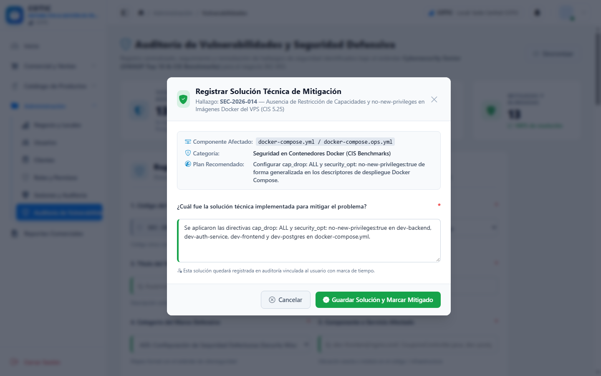

---

## 3. Resumen de Buenas Prácticas Operativas

1. **Apertura y Cierre Riguroso:** Todo turno de mostrador debe iniciar con el monto exacto de caja chica en el Módulo de Arqueo y cerrarse antes de abandonar la tienda.
2. **Uso del Histórico de Producto:** Antes de emitir una orden de compra a proveedores, consulte el botón `bi-clock-history` en Inventario para verificar la velocidad de salida de ese producto.
3. **Cierre de Pestaña Seguro:** Al retirarse de su puesto de trabajo, pulse el botón de cierre de sesión en la parte inferior del sidebar para destruir el token en memoria.
