# Guía Interactiva del Sistema para el Usuario Final
### Sistema de Distribución y Comercialización de Bebidas y Licores

> **¡Bienvenido a tu nuevo sistema de gestión comercial!**  
> Este documento ha sido diseñado pensando en ti, para que conozcas de forma clara y didáctica todas las funciones a las que tienes acceso según tu rol y tu local asignado.

---

## 🧭 ¿Cómo navegar por esta guía?

Puedes explorar esta guía directamente aquí o abrir el visor web interactivo comercial optimizado en tema claro y el spot animado:  
👉 **[Ver Video Promocional Animado HyperFrames (`docs/presentacion/video_promocional_bevadmin.html`)](file:///D:/tools/Proyectos/mio/sidebar-login/docs/presentacion/video_promocional_bevadmin.html)**  
👉 **[Abrir Presentación Interactiva Web (`docs/presentacion/PRESENTACION_INTERACTIVA_USUARIO.html`)](file:///D:/tools/Proyectos/mio/sidebar-login/docs/presentacion/PRESENTACION_INTERACTIVA_USUARIO.html)**  
👉 **[Explorar Diagramas Técnicos en Misma Pestaña (`docs/diagrams/index.html`)](file:///D:/tools/Proyectos/mio/sidebar-login/docs/diagrams/index.html)**

---

## 1. Acceso al Sistema y Seguridad de tu Cuenta

El sistema garantiza que tus operaciones y las de tu equipo se realicen bajo altos estándares de seguridad.

### 🔑 Inicio de Sesión (`/login`)
- Ingresa tu **correo institucional** (ej. `ana.garcia@empresa.com` o tu usuario `agarcia`) y tu contraseña.
- Si activas la casilla **"Recordar cuenta"**, el sistema recordará tu correo para que no tengas que escribirlo cada vez.

### 🛡️ Política de Contraseñas y Expiración (90 Días)
Tu seguridad es primordial. El sistema evalúa tu clave en cada inicio de sesión:

```mermaid
flowchart TD
    A["Ingreso de Credenciales en /login"] --> B{"Evaluación de Estado de Clave"}
    B -->|Clave Vigente| C["Ingreso Inmediato al Tablero Principal"]
    B -->|Aviso de Expiración (4 días)| D["Ingreso con Alerta Preventiva de Renovación"]
    B -->|Clave Expirada o Temporal| E["Modal de Cambio Obligatorio de Contraseña"]
    E -->|Nueva Clave Válida| C
    B -->|5 Intentos Fallidos| F["Cuenta Bloqueada por Seguridad (Contactar Administrador)"]

    style C fill:#16a34a,color:#fff
    style D fill:#d97706,color:#fff
    style E fill:#dc2626,color:#fff
    style F fill:#7f1d1d,color:#fff
```

1. **Clave Temporal (Primer Ingreso)**: Si el administrador creó tu cuenta recientemente, deberás establecer tu clave personal antes de ingresar.
2. **Aviso Preventivo**: 4 días antes de que tu clave cumpla los 90 días, verás un recordatorio para cambiarla cuando desees.
3. **Clave Expirada**: Si pasaron más de 90 días, el sistema te solicitará renovarla inmediatamente en pantalla para poder ingresar.
4. **Protección contra Bloqueo**: Al quinto intento fallido consecutivo, la cuenta se bloquea preventivamente para evitar accesos no autorizados.

### 🌐 Detección Automática de Caída del Backend y Notificación de Restablecimiento
El sistema cuenta con un monitor de alta disponibilidad que vigila la conectividad con el servidor Spring Boot en tiempo real:
- **Si el servidor backend se interrumpe**: El frontend detecta la caída inmediatamente (mediante interceptor HTTP y latidos *heartbeat*) y redirige al colaborador a `/login?serviceUnavailable=true`.
- **Bloqueo Preventivo de Autenticación**: Mientras el servidor esté caído, el botón de "Iniciar Sesión" se inhabilita mostrando el indicador `Servicio Fuera de Servicio (Bloqueado)` para evitar inconsistencias de datos o solicitudes fallidas.
- **Sondeo Inteligente y Contador Automático**: Cada 4 segundos se comprueba la salud de la API (`/api/v1/auth/health`), permitiendo también al usuario pulsar el botón *"Verificar Ahora"*.
- **Aviso Inmediato de Servicio Restablecido**: En el milisegundo en que el backend vuelve a responder, el sistema despliega el banner verde `¡Servicio Restablecido con Éxito!`, reactiva el formulario y permite iniciar sesión con normalidad.

---

## 2. Tu Negocio Matriz y tu Local Asignado

El sistema funciona con una jerarquía organizada:

```
[Negocio Matriz: Distribuidora El Roble S.A.C. - RUC 20601234567]
  ├── Local 1: Sede Central (Mayorista) ➔ Tu Local Asignado
  ├── Local 2: Tienda Norte (Licorería Express)
  ├── Local 3: Sucursal Sur (Distribuidora)
  └── Local 4: Tienda Este (Mayor y Menor)
```

- **¿Qué significa tu Local Asignado?**  
  Todas las ventas, los comprobantes electrónicos que imprimas y los arqueos de caja que realices quedarán registrados a nombre de esa sucursal física.

---

## 3. Tablero Principal de Control (`/dashboard/inicio`)

Es tu centro de mando al comenzar la jornada:
- **Tarjetas de KPIs**: Muestran el dinero facturado en el mes, el número de cajas de licores en stock y los pedidos de abastecimiento pendientes.
- **Bitácora de Auditoría en Vivo**: Te muestra en tiempo real qué compañeros están emitiendo ventas o recibiendo mercadería en los distintos locales de la empresa.

---

## 4. Punto de Venta (POS): Ventas por Mayor y por Menor (`/dashboard/sales`)

Aquí atiendes a tus clientes de manera rápida y sin complicaciones:

### Pasos para registrar una venta:
1. **Elige el Comprobante**: Selecciona si emitirás **Factura Electrónica** (empresas con RUC) o **Boleta de Venta** (consumidor final).
2. **Selecciona al Cliente y Medio de Pago**: Efectivo, Yape/Plin o Tarjeta POS.
3. **Agrega las Bebidas**:
   - **Venta por Mayor**: Te calcula el precio por caja o pack cerrado.
   - **Venta por Menor**: Te calcula el precio por botella o unidad individual.
4. **Aplica un Cupón de Descuento (Opcional)**: Si el cliente cuenta con un código promocional (ej. `MAYORISTA15`), escríbelo para descontar el porcentaje o monto fijo.
5. **Emite el Comprobante**: Presiona **"Emitir Comprobante"** para generar la venta y ver el comprobante listo para imprimir o guardar en PDF.

---

## 5. Mi Historial de Ventas (`/dashboard/sales-history`)

Un espacio exclusivo para ti:
- Consulta **únicamente las ventas que tú has registrado** en tu turno de trabajo.
- Visualiza el monto total acumulado que has facturado en el día.
- Reabre cualquier comprobante emitido anteriormente para reimprimirlo si el cliente te lo solicita.

---

## 6. Arqueo y Cierre de Caja (`/dashboard/cash-register`)

Al finalizar tu turno laboral (Mañana, Tarde o Cierre), realiza el cuadre de tu dinero:
1. El sistema toma el fondo inicial de tu caja, suma tus ventas en efectivo y resta los gastos menores autorizados.
2. Ingresas el **efectivo físico** que contaste en tu gaveta.
3. El sistema calcula al instante la diferencia y certifica el estado:
   - **Cuadre Exacto**: La gaveta coincide al centavo con el sistema.
   - **Sobrante**: Tienes más dinero físico que el registrado.
   - **Faltante**: Falta dinero respecto al sistema.
4. Presionas **"Cerrar Turno y Firmar Acta de Arqueo"** para archivar el cierre de forma inmutable.

---

## 7. Catálogo de Bebidas y Abastecimiento

- **Inventario Maestro (`/dashboard/products/list`)**: Busca licores, rones, piscos, cervezas o gaseosas por su nombre o código SKU. Revisa cuántas cajas y botellas quedan en stock.
- **Registrar Nueva Bebida (`/dashboard/products/add`)**: Para supervisores, permite dar de alta una nueva bebida definiendo su presentación y sus dos precios oficiales (precio por mayor y precio por menor).
- **Compras y Reabastecimiento (`/dashboard/purchases`)**: Registra la llegada de camiones de proveedores como Backus, Arca Continental Lindley o Diageo para incrementar las cajas en almacén.
- **Cupones de Descuento (`/dashboard/coupons`)**: Crea beneficios promocionales para premiar a clientes mayoristas recurrentes.

---

## 8. Módulo de Administración (Solo Administradores y Supervisores)

Conectado en tiempo real a la base de datos empresarial:
- **Negocio y Locales (`/dashboard/branches`)**: Administra la red de tiendas de la empresa, sus direcciones y sus series de facturación electrónica.
- **Clientes y Usuarios (`/dashboard/users`)**: Da de alta a nuevos colaboradores, asígnales su local principal de trabajo y marca en qué otras sucursales tienen autorización para entrar.
- **Roles y Permisos (`/dashboard/roles`)**: Define con casillas de verificación qué opciones de menú puede Ver, Crear o Editar cada tipo de usuario (Administrador, Supervisor, Cajero o Auditor).

---

## 9. Configuración y Cambio Voluntario de Contraseña (`/dashboard/settings`)

- Si deseas renovar tu contraseña voluntariamente antes de los 90 días, puedes ingresar a esta vista, digitar tu clave actual y definir una nueva.
- La nueva contraseña te otorgará un nuevo ciclo de **90 días de validez corporativa**.

---

## 🔄 10. Flujo Operativo Integral: ¿Cómo interactúan todos los módulos entre sí?

El siguiente diagrama ilustra cómo viaja la información entre todas las pantallas del sistema durante una jornada real de trabajo:

```mermaid
flowchart TD
    subgraph S1 ["1. Apertura e Inicio"]
        M1["/login\n(Inicio de Sesión)"] --> M2["/dashboard/inicio\n(Tablero General & KPIs)"]
        M2 --> M3["Verificación de Local Asignado\n(ej. Sede Central Mayorista)"]
    end

    subgraph S2 ["2. Abastecimiento de Mercadería"]
        M3 --> M4["/dashboard/purchases\n(Recepción de Compras a Proveedores)"]
        M4 -->|Incrementa Cajas| M5["/dashboard/products/list\n(Inventario Actualizado en Cajas & Unidades)"]
    end

    subgraph S3 ["3. Venta y Fidelización"]
        M5 --> M6["/dashboard/coupons\n(Creación de Cupón Mayorista)"]
        M6 --> M7["/dashboard/sales\n(Punto de Venta POS)"]
        M7 -->|Descuenta Stock & Aplica Cupón| M8["Comprobante Electrónico PDF\n(Factura / Boleta Emitida)"]
        M8 --> M9["/dashboard/sales-history\n(Mi Historial Personal de Ventas)"]
    end

    subgraph S4 ["4. Cierre y Control Financiero"]
        M9 --> M10["/dashboard/cash-register\n(Arqueo de Caja & Cuadre de Gaveta)"]
        M10 --> M11["Firma de Acta de Cierre de Turno"]
    end

    subgraph S5 ["5. Gobernanza y Reportes (Admin)"]
        M11 --> M12["/dashboard/branches & /users\n(Sincronización con PostgreSQL)"]
        M12 --> M13["/dashboard/reports\n(Descarga de Kardex y Reportes Comerciales)"]
    end

    style S1 fill:#0f172a,stroke:#38bdf8,stroke-width:2px,color:#fff
    style S2 fill:#064e3b,stroke:#34d399,stroke-width:2px,color:#fff
    style S3 fill:#1e1b4b,stroke:#818cf8,stroke-width:2px,color:#fff
    style S4 fill:#451a03,stroke:#fbbf24,stroke-width:2px,color:#fff
    style S5 fill:#1f2937,stroke:#a855f7,stroke-width:2px,color:#fff
```



### Tabla de Interacción de Datos entre Módulos:

| Paso | Interfaz Origen | Acción Realizada por el Usuario | Interfaz Destino / Impacto en el Sistema |
| :---: | :--- | :--- | :--- |
| **1** | `/login` | Inicia sesión con usuario y contraseña | Valida vigencia de clave, genera token JWT e inicializa la sesión en `/dashboard/inicio`. |
| **2** | `/dashboard/purchases` | Recepciona 50 cajas de cerveza de Backus | Actualiza automáticamente el stock en `/dashboard/products/list` incrementando las cajas del local. |
| **3** | `/dashboard/coupons` | Crea el cupón `MAYORISTA15` (15% OFF) | Habilita el código para ser consumido en el carrito del Punto de Venta `/dashboard/sales`. |
| **4** | `/dashboard/sales` | Cobra factura por 10 cajas de pisco aplicando el cupón | Emite `F001-0089`, descuenta las 10 cajas del inventario y envía el comprobante a `/dashboard/sales-history`. |
| **5** | `/dashboard/sales-history` | Revisa el comprobante y verifica el total de $85 | Permite reimprimir o descargar en PDF el comprobante entregado al cliente. |
| **6** | `/dashboard/cash-register` | Cuenta el efectivo físico en gaveta ($385) | Compara con las ventas del día ($85) + fondo de apertura ($300) y certifica **Cuadre Exacto**. |
| **7** | `/dashboard/branches` & `/users` | Da de alta una nueva sucursal y vendedor | Sincroniza en PostgreSQL las tablas `branches`, `users` y `user_branches`. |
| **8** | `/dashboard/reports` | Exporta el resumen del día | Descarga el archivo oficial con la auditoría de ventas, compras y cierres de caja. |

---


---

## 🛡️ 9. Centro de Ciberseguridad: Sesiones Activas y Expulsión Remota (`/dashboard/sessions`)

Para garantizar la integridad y confidencialidad del negocio, los Administradores cuentan con una consola de auditoría concurrente en tiempo real:

- **Auditoría Forense de Red y Dispositivo**: Identifica con precisión la **dirección IP de origen**, el **navegador web (User-Agent)** y el sistema operativo de cada usuario con sesión iniciada.
- **Indicadores Semaforizados de Conexión**:
  - 🟢 **En Línea**: Usuario con actividad en los últimos 30 segundos (emisión de latidos *heartbeat* continuos).
  - 🟡 **Ausente / Inactivo**: Sesión abierta pero sin latidos recientes.
  - 🔴 **Desconectado / Revocado**: Sesión cerrada voluntariamente o expulsada administrativamente.
- **Geolocalización Forense y Visor de Mapa**: Mapeo visual y coordenadas geográficas (latitud / longitud) calculadas a partir de la IP para identificar accesos anómalos fuera de las ciudades de operación.
- **Cierre Forzado Remoto (Kill Session)**: Permite expulsar a cualquier colaborador o intruso con un solo clic. El servidor invalida su token JWT de inmediato y el frontend del usuario lo redirige instantáneamente a la pantalla de login mostrando la alerta de revocación de seguridad.
- **Bloqueo Administrativo de Cuenta**: En caso de sospecha grave de intrusión o intento de fraude, el Administrador puede bloquear la cuenta completa directamente desde la misma fila.

## 🗺️ 11. Diagrama de Flujo y Conexión entre Opciones de Menú (Para el Usuario Final)

Para que cualquier colaborador (cajeros, supervisores de tienda, almaceneros o administradores) comprenda con claridad cómo se comunican las distintas opciones del menú lateral, el siguiente diagrama ilustra cómo viaja la información entre los menús a lo largo del ciclo operativo de tu negocio:

```mermaid
flowchart TD
    subgraph F1 ["1. Gobernanza, Sedes y Control de Accesos"]
        M_Branches["🏢 Negocio y Locales
(/dashboard/branches)"] -->|Asigna Tiendas y Sedes| M_Users["👥 Clientes y Usuarios
(/dashboard/users)"]
        M_Roles["🛡️ Roles y Permisos
(/dashboard/roles)"] -->|Define Permisos RBAC| M_Users
        M_Users -->|Genera Acceso Seguro| M_Login["🔑 /login
(Ingreso con clave de 90 días)"]
        M_Login -->|IP, Navegador & Heartbeat| M_Sessions["🚨 Sesiones y Auditoría
(/dashboard/sessions)"]
        M_Sessions -->|Expulsión Remota Kill Session| M_Login
    end

    subgraph F2 ["2. Catálogo y Abastecimiento de Mercadería"]
        M_Categories["🏷️ Categorías
(/dashboard/categories)"] -->|Clasifica Líneas de Bebidas| M_Products["📦 Productos e Inventario
(/dashboard/products/list)"]
        M_Purchases["🚚 Compras y Recepción
(/dashboard/purchases)"] -->|INCREMENTA STOCK (+Cajas)| M_Products
    end

    subgraph F3 ["3. Comercialización y Punto de Venta (POS)"]
        M_Coupons["🎟️ Cupones y Promociones
(/dashboard/coupons)"] -->|Aplica % o Rebajas en Carrito| M_Sales["🛒 Ventas (Punto de Venta POS)
(/dashboard/sales)"]
        M_Products -->|Entrega Catálogo y Valida Stock| M_Sales
        M_Sales -->|DESCUENTA STOCK EN TIEMPO REAL| M_Products
    end

    subgraph F4 ["4. Control de Turno y Arqueo de Caja"]
        M_Sales -->|Archiva Boletas y Facturas Electrónicas| M_History["🧾 Historial de Ventas
(/dashboard/sales-history)"]
        M_Sales -->|Acumula Dinero Cobrado en Gaveta| M_Cash["💰 Arqueo y Cierre de Caja
(/dashboard/cash-register)"]
        M_History -->|Respalda Transacciones del Turno| M_Cash
    end

    subgraph F5 ["5. Dirección Ejecutiva, Auditoría y Perfil"]
        M_Sales -.->|Suma Total Vendido Hoy| M_Home["📊 Inicio (Tablero General)
(/dashboard/inicio)"]
        M_Products -.->|Alerta de Stock Mínimo| M_Home
        M_Cash -.->|Estado de Caja Abierta/Cerrada| M_Home
        
        M_Sales -->|Libros de Ventas Oficiales| M_Reports["📑 Reportes y Auditoría
(/dashboard/reports)"]
        M_Purchases -->|Kardex de Entradas| M_Reports
        M_Cash -->|Actas de Cierre Firmadas| M_Reports

        M_Settings["⚙️ Configuración / Mi Perfil
(/dashboard/settings)"] -->|Renovación Voluntaria de Clave| M_Login
    end

    style F1 fill:#0f172a,stroke:#38bdf8,stroke-width:2px,color:#fff
    style F2 fill:#064e3b,stroke:#34d399,stroke-width:2px,color:#fff
    style F3 fill:#1e1b4b,stroke:#fbbf24,stroke-width:2px,color:#fff
    style F4 fill:#451a03,stroke:#f43f5e,stroke-width:2px,color:#fff
    style F5 fill:#1f2937,stroke:#a855f7,stroke-width:2px,color:#fff
```

---

### Matriz de Interconexión de Menús para el Usuario Final:

| Opción de Menú | ¿De qué menús recibe información previa? | ¿Hacia qué menús viaja su información o qué habilita? | ¿Quién lo opera en la empresa? | Ejemplo práctico de uso diario |
| :--- | :--- | :--- | :--- | :--- |
| **🏢 Negocio y Locales**<br>`/dashboard/branches` | Configuración inicial de la razón social y sedes físicas. | Alimenta a **Clientes y Usuarios** (asigna sedes) y a **Inventario** (aísla stock por tienda). | Administrador General | Se inaugura una nueva sucursal en Chorrillos; se da de alta con su serie F002 y se le asigna personal. |
| **🛡️ Roles y Permisos**<br>`/dashboard/roles` | Políticas de gobernanza y auditoría interna. | Filtra y oculta las opciones del menú lateral para cada **Usuario** (Cajero, Jefe, Auditor). | Oficial de Seguridad / Admin | Para el rol "Cajero", se desmarcan los reportes contables; al ingresar, el cajero solo ve su punto de cobro. |
| **👥 Clientes y Usuarios**<br>`/dashboard/users` | Recibe sedes de **Negocio y Locales** y perfiles de **Roles y Permisos**. | Habilita credenciales en **/login** con ciclo de contraseña de 90 días. | Recursos Humanos / Admin | Se contrata a un cajero para la Sede Norte; se le activa su cuenta y su local asignado. |
| **🏷️ Categorías**<br>`/dashboard/categories` | Estructura de familias comerciales de bebidas. | Organiza a **Productos** y habilita filtros rápidos en **Ventas (POS)**. | Jefe de Tienda / Admin | El cajero pulsa "Cervezas" en pantalla y solo visualiza las marcas de cerveza, cobrando en segundos. |
| **🚚 Compras y Recepción**<br>`/dashboard/purchases` | Selecciona catálogo de **Productos** y sedes de **Negocio y Locales**. | **INCREMENTA STOCK AUTOMÁTICO** en **Productos** y registra costos en **Reportes**. | Encargado de Almacén | Llega camión de Backus con 100 cajas de Cristal; se recepciona y de inmediato quedan listas para la venta. |
| **📦 Productos e Inventario**<br>`/dashboard/products/list` | Abastecido por **Compras** y descontado por **Ventas (POS)**. | Provee existencias a **Ventas (POS)** y emite alertas de stock crítico a **Inicio**. | Almaceneros, Cajeros y Jefes | Muestra stock exacto de cada bebida con sus dos precios oficiales: por mayor y por menor. |
| **🎟️ Cupones y Promociones**<br>`/dashboard/coupons` | Campañas de fidelización comercial de la gerencia. | Aplica descuentos automáticos en el carrito de compras de **Ventas (POS)**. | Gerente Comercial / Tienda | Se activa el cupón `MAYORISTA15` (15% OFF); el cajero lo ingresa y el descuento se refleja en el ticket. |
| **🛒 Ventas (Punto de Venta POS)**<br>`/dashboard/sales` | Consulta stock de **Productos** y aplica rebajas de **Cupones**. | **DESCUENTA STOCK EN TIEMPO REAL**, archiva en **Historial** y suma dinero a **Arqueo de Caja**. | Cajeros Minoristas y Mayoristas | Un cliente compra 10 cajas de pisco; se emite la Factura F001-0089, se descuentan 10 cajas y el dinero entra a caja. |
| **🧾 Historial de Ventas**<br>`/dashboard/sales-history` | Recibe cada comprobante generado en **Ventas (POS)**. | Permite reimprimir PDF de comprobantes y respalda las ventas para el **Arqueo de Caja**. | Cajeros y Supervisores | Un cliente extravió su factura; el cajero ingresa su RUC, ubica la venta y la reimprime al instante. |
| **💰 Arqueo y Cierre de Caja**<br>`/dashboard/cash-register` | Recibe los cobros en efectivo y tarjeta de **Ventas (POS)**. | Compara dinero físico contado contra ventas y genera Acta de Cierre para **Reportes**. | Cajeros y Supervisores de Caja | Al cerrar el turno, el cajero cuenta billetes en gaveta y certifica Cuadre Conforme (diferencia $0.00). |
| **📊 Inicio (Tablero General)**<br>`/dashboard/inicio` | Consolida en vivo datos de **Ventas**, **Inventario** y **Caja**. | Guía ejecutiva diaria con KPIs de ventas recaudadas y alertas de reposición urgente. | Todos los usuarios | Al comenzar el día, el jefe de tienda revisa cuánto se vendió ayer y qué productos requieren pedido. |
| **📑 Reportes y Auditoría**<br>`/dashboard/reports` | Recibe movimientos de **Ventas**, **Compras**, **Inventario** y **Caja**. | Exporta libros de ventas fiscales y Kardex valorizado en Excel/PDF para contabilidad. | Contadores, Jefes y Gerencia | A fin de mes, contabilidad descarga los reportes oficiales y libros electrónicos para SUNAT. |
| **⚙️ Configuración / Mi Perfil**<br>`/dashboard/settings` | Acceso personal de cada colaborador con sesión iniciada. | Renueva voluntariamente tu contraseña otorgando un nuevo ciclo de **90 días de validez**. | Todos los colaboradores | Al cumplir 60 días con su clave, el usuario la renueva para evitar avisos preventivos de expiración. |


---

## 📋 Resumen Rápido por Rol de Usuario

| Rol | ¿Qué puedes hacer en el sistema? |
| :--- | :--- |
| **Cajero / Vendedor (Mayor/Menor)** | Atender en el Punto de Venta (POS), emitir boletas y facturas, consultar tu propio historial de ventas y realizar el arqueo de tu caja de turno. |
| **Jefe de Tienda y Compras** | Supervisar inventarios, registrar ingresos de compras de proveedores, crear cupones y validar los arqueos de caja del personal. |
| **Auditor de Operaciones** | Consultar en modo lectura los comprobantes emitidos, revisar la bitácora de auditoría y exportar los reportes comerciales sin poder alterar datos. |
| **Administrador General** | Acceso total al sistema, creación de usuarios, configuración de locales, control de roles y políticas de seguridad en base de datos. |

---

*Guía generada para el equipo operativo y administrativo del Sistema de Distribución de Bebidas.*  
*Archivo interactivo disponible en la raíz del proyecto: [`PRESENTACION_INTERACTIVA_USUARIO.html`](file:///D:/tools/Proyectos/mio/sidebar-login/PRESENTACION_INTERACTIVA_USUARIO.html).*
