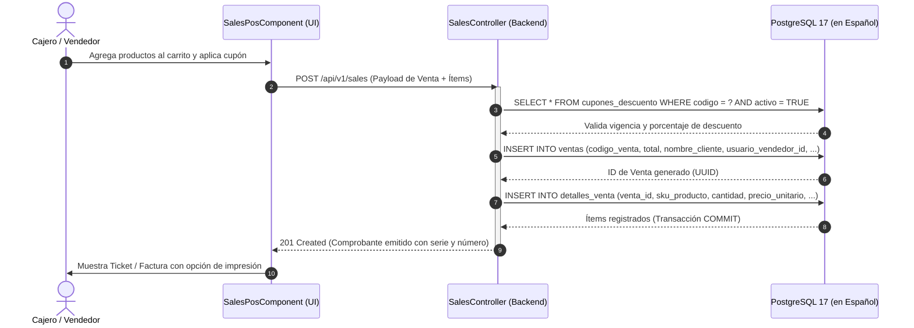
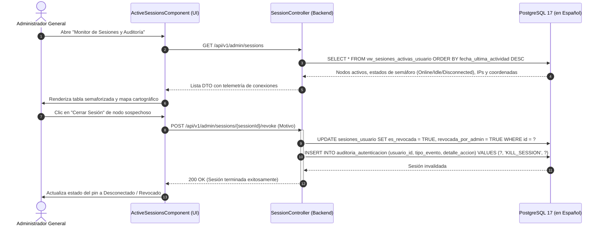
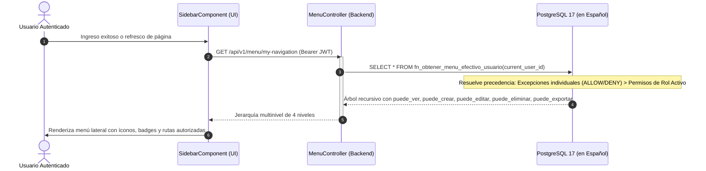

# 🗺️ Mapeo Técnico Integral: Interfaces Frontend, APIs RESTful y Objetos de Base de Datos en Español

> [!TIP] **Diagramas Interactivos Autónomos de la Arquitectura (Archify)**  
> Se encuentran disponibles los diagramas interactivos de alta fidelidad con soporte de temas claro/oscuro, zoom, navegación y exportación:
> - 🌐 **[Portal Central de Diagramas (`docs/diagrams/index.html`)](file:///D:/tools/Proyectos/mio/sidebar-login/docs/diagrams/index.html)**
> - ☁️ **[Portal de Arquitecturas Cloud y Costos (`docs/cloud/index.html`)](file:///D:/tools/Proyectos/mio/sidebar-login/docs/cloud/index.html)**
> - 🏛️ **[01. Arquitectura C4 Contenedores y Red Docker](file:///D:/tools/Proyectos/mio/sidebar-login/docs/diagrams/01_arquitectura_sistema.html)**
> - 🧾 **[02. Secuencia: Emisión de Venta POS y Cupones](file:///D:/tools/Proyectos/mio/sidebar-login/docs/diagrams/02_secuencia_emision_venta.html)**
> - 🛡️ **[03. Secuencia: Auditoría NOC y Kill Session](file:///D:/tools/Proyectos/mio/sidebar-login/docs/diagrams/03_secuencia_monitoreo_sesiones.html)**
> - 🧭 **[04. Secuencia: Menú Dinámico y RBAC Jerárquico](file:///D:/tools/Proyectos/mio/sidebar-login/docs/diagrams/04_secuencia_menu_dinamico_rbac.html)**
> - ⚡ **[05. Flujo Operativo End-to-End (Workflow)](file:///D:/tools/Proyectos/mio/sidebar-login/docs/diagrams/05_flujo_operativo_negocio.html)**
> - 🗄️ **[06. Modelo de Datos Relacional ERD en Español](file:///D:/tools/Proyectos/mio/sidebar-login/docs/diagrams/06_modelo_datos_erd.html)**

Este documento técnico detalla la arquitectura de integración punto a punto entre las **18 interfaces de usuario habilitadas en el Frontend (Angular 21)**, los **Endpoints y Servicios de la API RESTful (Spring Boot 4 / Java 21)** y los **Objetos de Base de Datos relacionales (PostgreSQL 17)** estructurados 100% en idioma español que son consultados y actualizados en cada operación.

---

## 1. Diagrama de Arquitectura y Flujo de Datos

El siguiente diagrama ilustra la interacción entre las capas del sistema con la base de datos completamente en español:

```mermaid
flowchart TD
    subgraph UI["Capa Cliente (Frontend Angular 21)"]
        UI_AUTH["Autenticación & Login (/login)"]
        UI_SHELL["Shell, Sidebar & Notificaciones"]
        UI_COM["Módulo Comercial (POS, Historial, Cupones, Caja)"]
        UI_CAT["Catálogo (Productos, Categorías)"]
        UI_ADM["Administración (Sedes, Usuarios, Roles RBAC, Sesiones NOC)"]
    end

    subgraph API["Capa de Negocio (Spring Boot 4 REST API)"]
        API_AUTH["AuthController (/api/v1/auth)"]
        API_MENU["MenuController (/api/v1/menu)"]
        API_NOTIF["NotificationsController (/api/v1/notifications)"]
        API_SALES["SalesController (/api/v1/sales)"]
        API_COUP["CouponsController (/api/v1/coupons)"]
        API_CASH["CashRegisterController (/api/v1/cash-register)"]
        API_CAT["CatalogController (/api/v1/products, /categories)"]
        API_ORG["OrganizationController (/api/v1/businesses, /branches)"]
        API_USR["UsersController (/api/v1/users)"]
        API_ROLE["RolesController (/api/v1/roles)"]
        API_SESS["SessionController (/api/v1/admin/sessions)"]
    end

    subgraph DB["Capa de Persistencia (PostgreSQL 17 en Español)"]
        DB_AUTH["usuarios, usuario_roles, sesiones_usuario, auditoria_autenticacion"]
        DB_MENU["fn_obtener_menu_efectivo_usuario(), opciones_menu, permisos_rol_menu"]
        DB_NOTIF["notificaciones_sistema"]
        DB_SALES["vw_ventas_con_detalles_comprobante, ventas, detalles_venta"]
        DB_COUP["cupones_descuento"]
        DB_CASH["arqueos_caja"]
        DB_CAT["productos_bebidas, categorias_bebidas"]
        DB_ORG["empresas, sedes"]
        DB_USR["vw_usuarios_empresas_sedes, usuario_sedes"]
        DB_ROLE["roles, permisos_rol_menu"]
        DB_SESS["vw_sesiones_activas_usuario, sesiones_usuario"]
    end

    UI_AUTH --> API_AUTH --> DB_AUTH
    UI_SHELL --> API_MENU --> DB_MENU
    UI_SHELL --> API_NOTIF --> DB_NOTIF
    UI_COM --> API_SALES --> DB_SALES
    UI_COM --> API_COUP --> DB_COUP
    UI_COM --> API_CASH --> DB_CASH
    UI_CAT --> API_CAT --> DB_CAT
    UI_ADM --> API_ORG --> DB_ORG
    UI_ADM --> API_USR --> DB_USR
    UI_ADM --> API_ROLE --> DB_ROLE
    UI_ADM --> API_SESS --> DB_SESS
```

---

## 2. Matriz Detallada de Interfaces, APIs y Objetos de Base de Datos

A continuación se describe cada una de las interfaces de usuario habilitadas, indicando su componente Angular, los métodos HTTP consumidos del servicio `AdminApiService`, el controlador Spring Boot correspondiente y las tablas, vistas o funciones de PostgreSQL en español involucradas.

| # | Interfaz y Ruta UI | Componente Angular | Métodos y Endpoints API | Controlador Backend | Tablas / Objetos de BD Consultados / Afectados |
|---|-------------------|-------------------|------------------------|---------------------|------------------------------------------------|
| **1** | **Inicio / Dashboard General** `/dashboard/inicio` | `HomeViewComponent` | • `GET /api/v1/sales` • `GET /api/v1/cash-register/audits` • `GET /api/v1/products` • `GET /api/v1/branches` • `GET /api/v1/notifications` | `SalesController` `CashRegisterController` `CatalogController` `OrganizationController` | • `ventas`, `detalles_venta` • `arqueos_caja` • `productos_bebidas` • `sedes` • `notificaciones_sistema` |
| **2** | **Ventas Mayor / Menor (POS)** `/dashboard/sales` | `SalesPosComponent` | • `GET /api/v1/products` • `GET /api/v1/coupons` • `POST /api/v1/sales` | `CatalogController` `CouponsController` `SalesController` | • `productos_bebidas` • `cupones_descuento` • `ventas` *(INSERT)* • `detalles_venta` *(INSERT en lote)* |
| **3** | **Historial de Ventas Emitidas** `/dashboard/sales-history` | `SalesHistoryComponent` | • `GET /api/v1/sales/my-history` | `SalesController` | • `vw_ventas_con_detalles_comprobante` *(Filtra por usuario_vendedor_id sobre ventas, empresas, sedes, usuarios)* |
| **4** | **Compras y Abastecimiento** `/dashboard/purchases` | `PurchasesViewComponent` | • `GET /api/v1/purchases` • `POST /api/v1/purchases` • `GET /api/v1/branches` | `PurchasesController` `OrganizationController` | • `compras` • `sedes` • `empresas` |
| **5** | **Cupones de Descuento** `/dashboard/coupons` | `CouponsViewComponent` | • `GET /api/v1/coupons` • `POST /api/v1/coupons` • `PATCH /api/v1/coupons/{code}/toggle` | `CouponsController` | • `cupones_descuento` *(SELECT, INSERT, UPDATE activo)* |
| **6** | **Arqueo y Cierre de Caja** `/dashboard/cash-register` | `CashRegisterViewComponent` | • `GET /api/v1/cash-register/audits` • `POST /api/v1/cash-register/audits` | `CashRegisterController` | • `arqueos_caja` • `sedes` • `usuarios` |
| **7** | **Inventario de Productos** `/dashboard/products/list` | `ProductsListComponent` | • `GET /api/v1/products` • `GET /api/v1/categories` | `CatalogController` | • `productos_bebidas` • `categorias_bebidas` |
| **8** | **Registrar Nueva Bebida** `/dashboard/products/add` | `ProductAddComponent` | • `GET /api/v1/categories` • `POST /api/v1/products` | `CatalogController` | • `categorias_bebidas` • `productos_bebidas` *(INSERT)* |
| **9** | **Líneas y Categorías** `/dashboard/categories` | `CategoriesListComponent` | • `GET /api/v1/categories` | `CatalogController` | • `categorias_bebidas` |
| **10** | **Nueva Categoría** `/dashboard/categories/new` | `CategoryAddComponent` | • `POST /api/v1/categories` | `CatalogController` | • `categorias_bebidas` *(INSERT)* |
| **11** | **Negocio y Locales (Sedes)** `/dashboard/branches` | `BranchesManagementComponent` | • `GET /api/v1/businesses` • `POST /api/v1/businesses` • `GET /api/v1/branches` | `OrganizationController` | • `empresas` • `sedes` |
| **12** | **Clientes y Usuarios** `/dashboard/users` | `UsersManagementComponent` | • `GET /api/v1/users` • `POST /api/v1/users` • `GET /api/v1/roles` • `GET /api/v1/branches` | `UsersController` `RolesController` `OrganizationController` | • `vw_usuarios_empresas_sedes` • `usuarios` *(INSERT)* • `usuario_roles` *(INSERT)* • `usuario_sedes` *(INSERT múltiple)* |
| **13** | **Roles y Matriz RBAC** `/dashboard/roles` | `RolesManagementComponent` | • `GET /api/v1/roles` • `POST /api/v1/roles` • `GET /api/v1/roles/{code}/permissions` • `PUT /api/v1/roles/{code}/permissions` | `RolesController` | • `roles` • `permisos_rol_menu` *(SELECT / UPSERT)* • `opciones_menu` • `usuario_roles` |
| **14** | **Monitor de Sesiones y Auditoría** `/dashboard/sessions` | `ActiveSessionsComponent` | • `GET /api/v1/admin/sessions` • `POST /api/v1/admin/sessions/{id}/revoke` • `POST /api/v1/admin/sessions/users/{id}/lock` | `SessionController` | • `vw_sesiones_activas_usuario` • `sesiones_usuario` *(UPDATE es_revocada = TRUE)* • `usuarios` *(UPDATE estado = 'LOCKED')* • `auditoria_autenticacion` *(INSERT auditoría)* |
| **15** | **Reportes Comerciales** `/dashboard/reports` | `ReportsViewComponent` | • `GET /api/v1/sales` • `GET /api/v1/branches` | `SalesController` `OrganizationController` | • `vw_ventas_con_detalles_comprobante` • `ventas` • `sedes` |
| **16** | **Configuración de Sede y Negocio** `/dashboard/settings` | `SettingsViewComponent` | • `GET /api/v1/businesses` • `GET /api/v1/branches` | `OrganizationController` | • `empresas` • `sedes` • `usuarios` *(información de perfil)* |
| **17** | **Menú Lateral, Navbar & Avisos** *(Shell del Sistema)* | `SidebarComponent` `NavbarComponent` | • `GET /api/v1/menu/my-navigation` • `GET /api/v1/notifications` • `PATCH /api/v1/notifications/{code}/read` • `POST /api/v1/auth/heartbeat` | `MenuController` `NotificationsController` `AuthController` | • `fn_obtener_menu_efectivo_usuario(p_usuario_id)` • `opciones_menu` • `permisos_rol_menu` • `permisos_usuario_menu` • `notificaciones_sistema` • `sesiones_usuario` *(UPDATE fecha_ultima_actividad)* |
| **18** | **Autenticación y Login** `/login` | `Login` | • `POST /api/v1/auth/login` • `GET /api/v1/auth/health` | `AuthController` | • `usuarios` *(verificación hash_contrasena con BCrypt)* • `usuario_roles`, `roles` • `sedes`, `empresas` • `sesiones_usuario` *(INSERT sesión)* • `auditoria_autenticacion` *(INSERT auditoría)* |

---

## 3. Diagramas de Secuencia Técnicos

### 3.1. Flujo de Emisión de Venta en POS (`/dashboard/sales`)

### 3.2. Flujo de Monitoreo NOC y Cierre Remoto de Sesión (`/dashboard/sessions`)

### 3.3. Resolución de Menú RBAC en la Carga de la Aplicación

---

## 4. Mapeo Inverso: Objeto de Base de Datos en Español $\rightarrow$ Endpoints $\rightarrow$ Interfaces UI

Esta tabla permite verificar qué pantallas se verían impactadas ante modificaciones en la estructura de tablas o vistas en español:

| Objeto en PostgreSQL | Tipo | Endpoints Backend Asociados | Interfaces Frontend Afectadas |
|----------------------|------|-----------------------------|-------------------------------|
| **`empresas`** | Tabla | `GET/POST /businesses` | • `/dashboard/branches` • `/dashboard/settings` • `/login` |
| **`sedes`** | Tabla | `GET /branches` | • `/dashboard/branches` • `/dashboard/users` • `/dashboard/purchases` • `/dashboard/cash-register` |
| **`usuarios`** | Tabla | `GET/POST /users` `POST /auth/login` `POST /admin/sessions/users/{id}/lock` | • `/dashboard/users` • `/dashboard/sessions` • `/login` |
| **`vw_usuarios_empresas_sedes`** | Vista | `GET /users` | • `/dashboard/users` |
| **`roles`** | Tabla | `GET/POST /roles` | • `/dashboard/roles` • `/dashboard/users` |
| **`permisos_rol_menu`** | Tabla | `GET/PUT /roles/{code}/permissions` | • `/dashboard/roles` *(Matriz de Permisos)* • Menú Lateral |
| **`opciones_menu`** | Tabla | `GET /roles/{code}/permissions` `GET /menu/my-navigation` | • `/dashboard/roles` • Menú Lateral (`SidebarComponent`) |
| **`fn_obtener_menu_efectivo_usuario`** | Función | `GET /menu/my-navigation` | • Menú Lateral (`SidebarComponent`) |
| **`sesiones_usuario`** | Tabla | `GET /admin/sessions` `POST /admin/sessions/{id}/revoke` `POST /auth/heartbeat` `POST /auth/login` | • `/dashboard/sessions` • Navbar *(indicador de conexión)* • `/login` |
| **`vw_sesiones_activas_usuario`** | Vista | `GET /admin/sessions` | • `/dashboard/sessions` *(Monitor y Mapa NOC)* |
| **`auditoria_autenticacion`** | Tabla | `POST /auth/login` `POST /admin/sessions/{id}/revoke` | • `/dashboard/sessions` • Auditoría interna del sistema |
| **`productos_bebidas`** | Tabla | `GET/POST /products` | • `/dashboard/sales` *(POS)* • `/dashboard/products/list` • `/dashboard/products/add` • `/dashboard/inicio` |
| **`categorias_bebidas`** | Tabla | `GET/POST /categories` | • `/dashboard/categories` • `/dashboard/categories/new` • `/dashboard/products/add` |
| **`ventas` & `detalles_venta`** | Tablas | `GET/POST /sales` `GET /sales/my-history` | • `/dashboard/sales` *(POS)* • `/dashboard/sales-history` • `/dashboard/reports` • `/dashboard/inicio` |
| **`vw_ventas_con_detalles_comprobante`** | Vista | `GET /sales/my-history` `GET /sales` | • `/dashboard/sales-history` • `/dashboard/reports` |
| **`cupones_descuento`** | Tabla | `GET/POST /coupons` `PATCH /coupons/{code}/toggle` | • `/dashboard/coupons` • `/dashboard/sales` *(Aplicación en POS)* |
| **`arqueos_caja`** | Tabla | `GET/POST /cash-register/audits` | • `/dashboard/cash-register` • `/dashboard/inicio` |
| **`compras`** | Tabla | `GET/POST /purchases` | • `/dashboard/purchases` |
| **`notificaciones_sistema`** | Tabla | `GET /notifications` `PATCH /notifications/{code}/read` | • Navbar *(Centro de Notificaciones)* • `/dashboard/inicio` |
